# CounterSign: what we have built so far (review guide)

> **Note:** this page is a snapshot from Oct 23, before the history cleanup on Oct 24. Commit hashes in it are pre-cleanup; `git log --oneline main` shows the current ones (same subjects).

**As of:** Oct 23, 2026 (day one of the build). **Deadline:** Nov 13, 2026, 1:30 AM IST.

This guide explains what exists in the repository and in open work, how each piece works, and what still needs a decision. Diagrams are Mermaid: GitHub renders them, and VS Code shows them in the Markdown preview once a Mermaid preview extension is installed.

**Contents**
1. [The short version](#1-the-short-version)
2. [What CounterSign is, and how much of it exists](#2-what-countersign-is-and-how-much-of-it-exists)
3. [Progress against the plan](#3-progress-against-the-plan)
4. [Branches, commits and the open PR](#4-branches-commits-and-the-open-pr)
5. [The day one sandbox harness (C01 to C03)](#5-the-day-one-sandbox-harness-c01-to-c03)
6. [Keeping secrets out of everything](#6-keeping-secrets-out-of-everything)
7. [Webhook catcher and registration (C04)](#7-webhook-catcher-and-registration-c04)
8. [How the checks feed each other](#8-how-the-checks-feed-each-other)
9. [Dispute checks D8 to D10 (C06)](#9-dispute-checks-d8-to-d10-c06)
10. [The fixes from Codex's review](#10-the-fixes-from-codexs-review)
11. [PR #2: the mate's mock PayPal, scenarios and dashboard](#11-pr-2-the-mates-mock-paypal-scenarios-and-dashboard)
12. [Tests and checks](#12-tests-and-checks)
13. [Real sandbox results so far](#13-real-sandbox-results-so-far)
14. [Review checklist: open issues and decisions](#14-review-checklist-open-issues-and-decisions)
15. [How to run things](#15-how-to-run-things)
16. [Glossary](#16-glossary)

---

## 1. The short version

- **Documents (done):** `PLAN.md` (day one plan, schema, state machines), `CONTRACTS.md` v1.0.1 (interfaces between core and mate), `TASKS.md` (cards C01 to C28 and M01 to M20), `AGENTS.md` (ownership rules), plus updates to `HANDOFF.md`, `DECISIONS.md` and `CLAUDE.md`.
- **Core (two parallel workers):**
  - Codex built the project skeleton, the safe HTTP client and recorder, the resumable check runner and the D1 check (C01, C02, C03).
  - I built the webhook catcher (C04) and the three dispute checks D8 to D10 (C06), including fixes for two bugs Codex found in review.
- **First real sandbox run:** D1 ran against PayPal on Oct 23 and was **CONFIRMED**. The app's token has every scope we need, **including `disputes/create`**, which the plan assumed we would not get.
- **Mate (amanxsays):** M01, the mock PayPal skeleton, is merged into `main`. **PR #2 (open)** adds M02 to M08: payouts, faults, disputes, signed webhooks, the scenario format, the dashboard API and the web incident desk. It passes its own tests (190 Python tests, 5 Node tests), merges cleanly and stays green when combined with core's code (271 tests).
- **Not built yet:**
  - the payout checks D2 to D7 (C05) and the analysis checks D11 to D13 (C07);
  - the whole product core: database, state machines, shield, executor, agent and so on (C10 onward).
- **Needs your decision:** see [section 14](#14-review-checklist-open-issues-and-decisions). The most important item is that Codex's branch merged an **older** version of my dispute checks, without the three review fixes.

---

## 2. What CounterSign is, and how much of it exists

CounterSign is a money-operations assistant for a small marketplace that pays makers through PayPal Payouts and handles buyer disputes. Its principle is **"the AI proposes, the code countersigns"**:

- The AI agent reads data and writes **proposals** (for example "send evidence on this dispute" or "hold Maker B's payout").
- A deterministic **shield** checks every proposal against rules.
- Money-moving actions need the **owner's approval** where the rules say so.
- Only the **executor** calls PayPal's write APIs, using a write-ahead record so that a lost response can never cause a double payment.

The diagram shows the planned system from `PLAN.md` section 2. Green parts exist (some only in the open PR), and grey parts are not built yet.

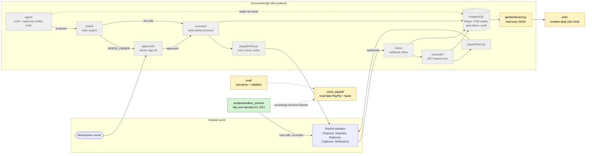

Legend: **green** = built on core branches; **yellow** = in mate's open PR #2 (the mock skeleton is already on `main`); **grey** = planned.

**Why the harness comes first.** `HANDOFF.md` section 9 lists PayPal behaviours marked "verify", such as whether UNCLAIMED is reliable, how disputes reach UNDER_REVIEW, and whether disputes hold funds. The product design depends on them. The rule is "do not assume, test first", so day one builds a harness that runs each experiment against the real sandbox, records every request and response, and writes a verdict. Those recordings then become the fixtures for the mock.

---

## 3. Progress against the plan

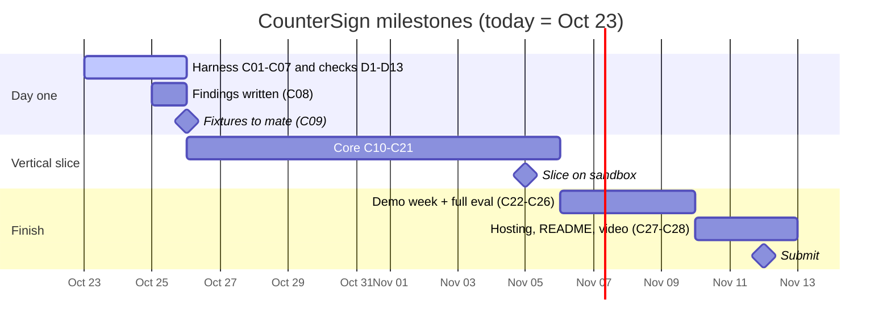

| Card | What | Owner | State | Where |
| --- | --- | --- | --- | --- |
| Docs | PLAN, CONTRACTS v1.0.1, TASKS, AGENTS, DECISIONS | you + me | Done | `main` (`63a36c4`) |
| C01 | Python skeleton, ruff, pytest, import-linter contracts | Codex | Done | `razeef/sandbox-harness` |
| C02 | Settings, redaction, recorder, HTTP client | Codex | Done | `razeef/sandbox-harness` |
| C03 | Resumable runner, manual steps, balance poller, D1 | Codex | Done | `razeef/sandbox-harness` |
| C04 | Webhook catcher and registration | me | Done | both core branches (`2d43d93`) |
| C05 | Payout checks D2 to D7 | Codex | **Not started** (no commits) | |
| C06 | Dispute checks D8 to D10 | me | Done, **fixes only on my branch** | see [section 4](#4-branches-commits-and-the-open-pr) |
| C07 | D11 to D13 and the toolkit allowlist test | Codex | **Not started** | |
| C08 | Run day one and write findings | you + core | **D1 run only** (`9bc72bb`) | `SANDBOX_FINDINGS.md` still empty |
| C09 to C28 | Product core, demo, submission | core | Not started | |
| M01 | Mock PayPal skeleton | mate | Merged | `main` (PR #1) |
| M02 to M08 | Payouts, faults, resources, webhooks, desk, dashboard API, scenarios | mate | **Open PR #2** | `refs/pull/2` |

---

## 4. Branches, commits and the open PR

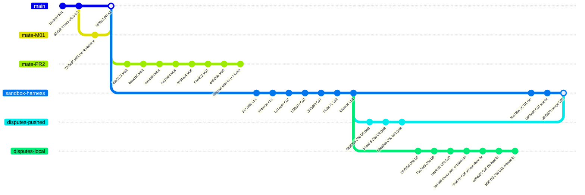

**Real branch names:**
- `sandbox-harness` is `razeef/sandbox-harness`: Codex's working branch, in the main checkout.
- `disputes-pushed` is `origin/razeef/webhooks-disputes`: the pushed copy of my branch.
- `disputes-local` is my local `razeef/webhooks-disputes`, in the `CounterSign-webhooks` worktree.
- `mate-PR2` is GitHub's `refs/pull/2/head`, from the mate's fork.

**What this shows:**
- **`95b5630` merged the old C06 commits.** They still carry the `Co-Authored-By` line and lack the three fixes. My local branch has the same C06 work rewritten without that line, plus the cherry-picked C03 test fix and the three fixes. Comparing them, the fixes add 309 lines to `d08_dispute_create.py`, `d10_settle.py` and `test_checks_disputes.py` that Codex's branch does not have.
- **My local branch has diverged from its pushed copy** (ahead 7, behind 3), because the history was rewritten. A plain `git push` will be refused.
- **No harness code is on `main` yet**, which follows the rule "do not merge into main". PR #2 is based on `main` and touches only folders the mate owns.

Commit messages follow Codex's style: one line `C0N: lowercase summary`, no body.

---

## 5. The day one sandbox harness (C01 to C03)

Everything lives in `scripts/sandbox_checks/`. It is deliberately **not** part of the product package: it is a lab tool a human runs from the terminal.

### 5.1 Module map

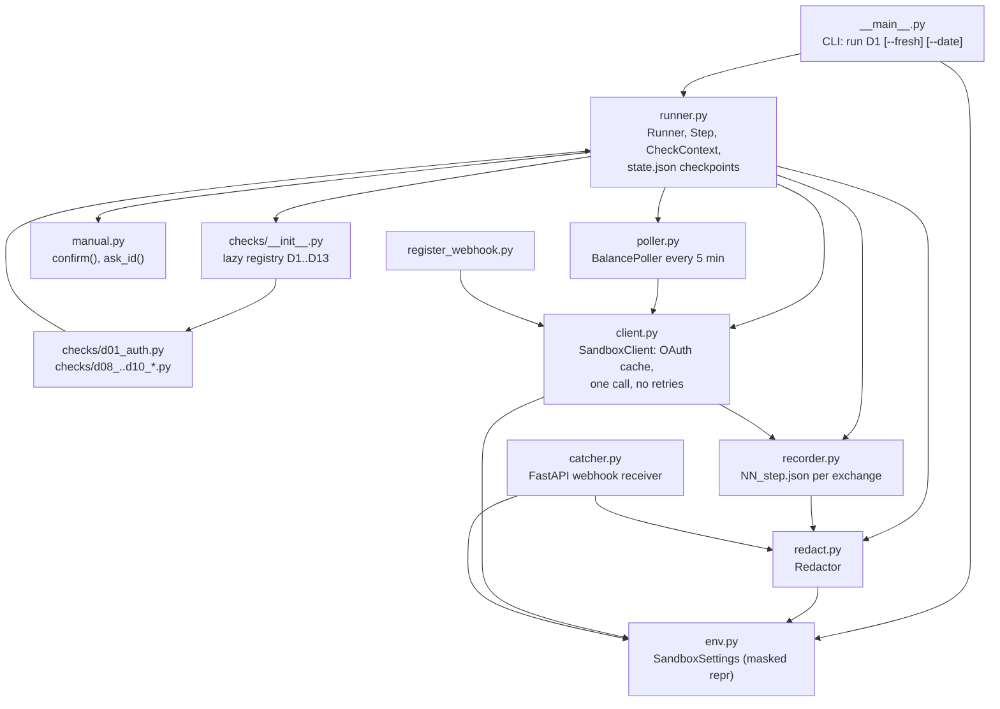

| Module | Job | Key safety behaviour |
| --- | --- | --- |
| `env.py` | Loads `.env` at run time into a frozen `SandboxSettings` | Refuses anything but `PAYPAL_ENV=sandbox`. `repr` prints `values=<redacted>`, and errors name variables, never values. |
| `redact.py` | Masks secrets and emails in anything written or printed | See [section 6](#6-keeping-secrets-out-of-everything). |
| `recorder.py` | Writes each HTTP exchange to `recordings/sandbox/<date>/<check>/<NN>_<step>.json` | Drops `Authorization` headers and redacts the rest. Files are created exclusively, so two writers can never overwrite each other. Unredacted copies are opt-in only and go to the gitignored `raw/`. |
| `client.py` | The only way checks talk to PayPal | Base URL is hard-coded to `api-m.sandbox.paypal.com`, and only relative paths are accepted. The token is cached and added to the redactor. **No automatic retries.** Transport errors are recorded and raised as `SandboxRequestError`, while HTTP errors are returned for the check to judge. |
| `runner.py` | Runs a check's ordered steps, saving progress after each | Every check except D1 refuses to run unless D1 is CONFIRMED. The saved state must match the step list. Errors show only the step name and exception type. |
| `manual.py` | Hands off to a human for browser actions | Waits in a background thread, so the balance poller keeps running. `ask_id` accepts only ID-shaped input and rejects anything that looks like an email, URL or secret. |
| `poller.py` | Appends `GET /v1/reporting/balances` to `balances.jsonl` every 5 minutes during any check | Failed reads are logged as unavailable, never as zero. |

### 5.2 What happens when you run a check

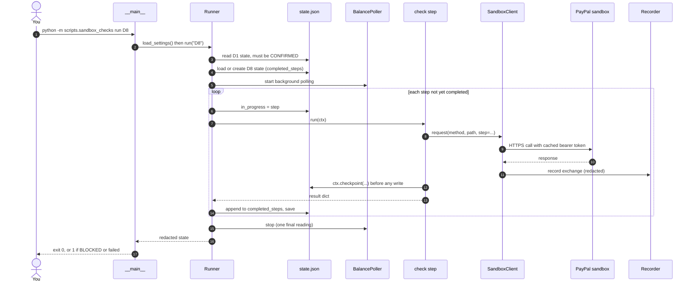

**Resuming.** If a step fails or you press Ctrl+C, the completed steps and the data saved so far stay in `state.json`. Running the same command again continues from the failed step. `--fresh` starts the steps over but keeps all existing evidence files.

### 5.3 Files on disk

```
recordings/sandbox/
├─ 2026-10-23/
│  ├─ D1/
│  │  ├─ 01_oauth_token.json        one redacted exchange per HTTP call
│  │  ├─ 02_balance_snapshot.json
│  │  ├─ state.json                 runner progress + check data (redacted)
│  │  └─ findings.json              the verdict and evidence list
│  └─ D8/ ...
├─ balances.jsonl                   poller readings, one JSON per line
├─ webhooks/<stamp>_<seq>_<id>.json redacted copy of each webhook delivery
├─ outcome_codes.json               every dispute outcome_code seen (D10)
└─ raw/                             GITIGNORED: exact webhook bytes, opt-in raw copies
```

`.gitignore` covers `.env` and `recordings/**/raw/` (verified with `git check-ignore`).

---

## 6. Keeping secrets out of everything

The repository is public and the recordings become the mate's fixtures, so every write and every printed line goes through the `Redactor`.

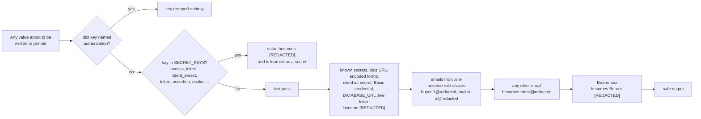

Other protections:
- **No values at import.** Settings load only when a human runs a check or starts the catcher, never when a module is imported.
- **No exception text in output.** Errors print only the type name, because transports can embed request data in messages.
- **Every test uses fake credentials and stubbed HTTP**, and asserts that none of those fake secrets or emails appear in any recording.
- **The dispute API's `PayPal-Auth-Assertion`** header contains the buyer email, so D8 registers it as a secret before using it.

---

## 7. Webhook catcher and registration (C04)

PayPal's signature check needs the **exact bytes** it sent, so the catcher keeps them untouched and separately writes a public, redacted copy.

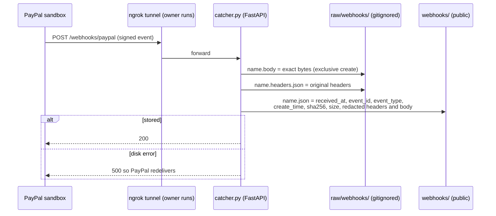

- **Duplicates** of the same event ID each get their own sequence number, so D11 can count them.
- **The catcher never verifies or acts on an event.** Verification is D11's job (C07, not built yet).
- **`register_webhook.py --url https://<tunnel>/webhooks/paypal`** subscribes to 20 event types, listed one by one because PayPal accepts `*` but not partial wildcards.
  - The types cover payout items, payout batches, disputes and captures.
  - The call is recorded under D11, and the script prints only the new webhook ID.
  - `--dry-run` shows the request body without needing credentials.
- **Rule for this phase:** no real registration, and no change to the existing ngrok endpoint. The code exists, but the owner decides when to run it.

---

## 8. How the checks feed each other

Each check reads earlier checks' saved data through `ctx.load_check_data("Dn")`. When the earlier check has not produced the data, it asks the operator for the ID instead of guessing.

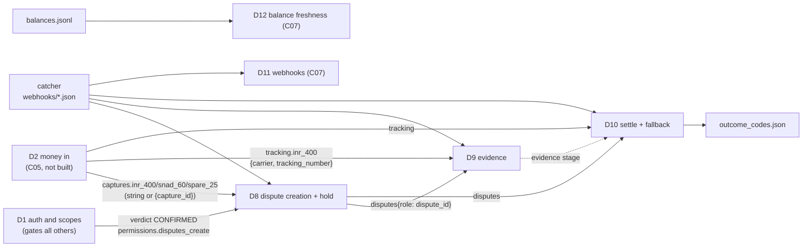

The D2 key shapes (`captures` and `tracking`) were agreed with Codex, and C05 will write them. Until C05 exists, D8 and D9 ask for the capture IDs and tracking details by hand.

---

## 9. Dispute checks D8 to D10 (C06)

### 9.1 Three rules every dispute check follows

1. **Write-ahead, never re-send.** Before any dispute write (create, escalate, accept-claim, adjudicate, require-evidence), the check saves "about to send X". If the run stops after sending, a resumed run finds that marker and **checks the dispute by GET** instead of sending again.
2. **Missing evidence is BLOCKED, never "no".** A failed balance read or a missing field cannot prove that a hold did *not* happen.
3. **Everything human is labelled staged.** Buyer actions happen in the sandbox Resolution Center by a person following printed instructions, and every prompt says "staged sandbox action". This also covers the script accepting a claim on the owner's behalf.

The three test disputes:

| Role | Order | Reason | Used for |
| --- | --- | --- | --- |
| `inr_400` | $400, Maker A | item not received | evidence (D9), seller-favour adjudication (D10) |
| `snad_60` | $60, Maker B | not as described | accept-claim refund (D10) |
| `spare_25` | $25 spare | item not received | API create route (D8), require-evidence and buyer-favour adjudication (D10), or the buyer-close fallback |

### 9.2 D8: can disputes be created, and does PayPal hold the money?

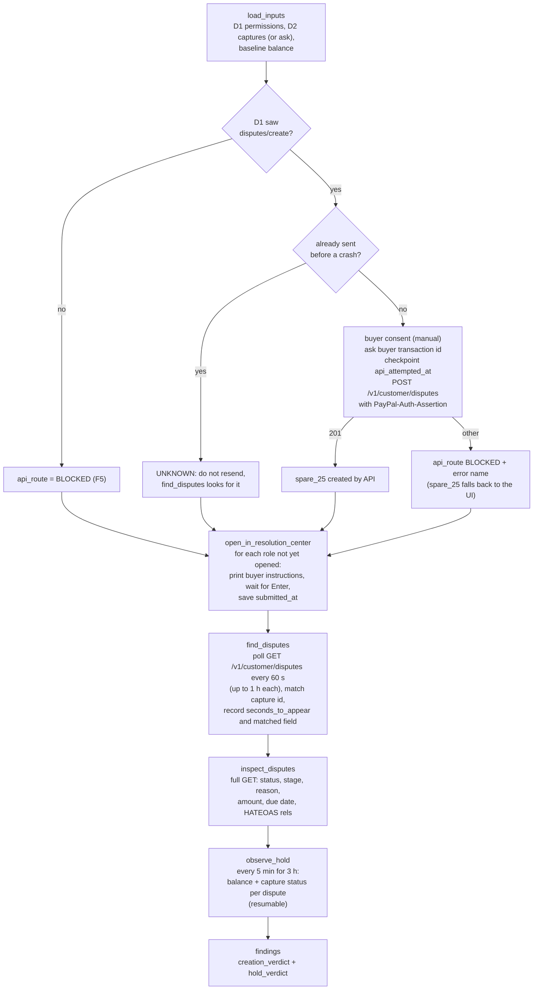

**How the verdict is decided:**
- `creation_verdict`: CONFIRMED if all three disputes were found, DIFFERENT if only some were, BLOCKED if none.
- `hold_verdict`: see [section 10.2](#102-d8-hold-evidence).
- **Overall:** BLOCKED if either part is BLOCKED; CONFIRMED only if both are CONFIRMED; otherwise DIFFERENT.

### 9.3 D9: can we submit evidence, and at which stage?

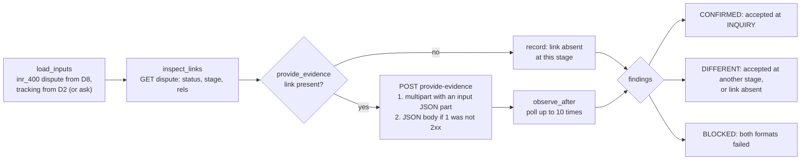

Evidence is `PROOF_OF_FULFILLMENT` with carrier and tracking number. The findings note that PayPal's tracking data is whatever the merchant uploaded, not proof from the carrier (F10).

### 9.4 D10: how do disputes settle?

The dispute lifecycle D10 explores. The arrows are what the docs suggest, and **D10 records what actually happens**:

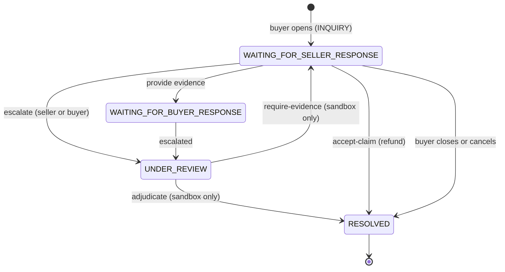

D10 steps:

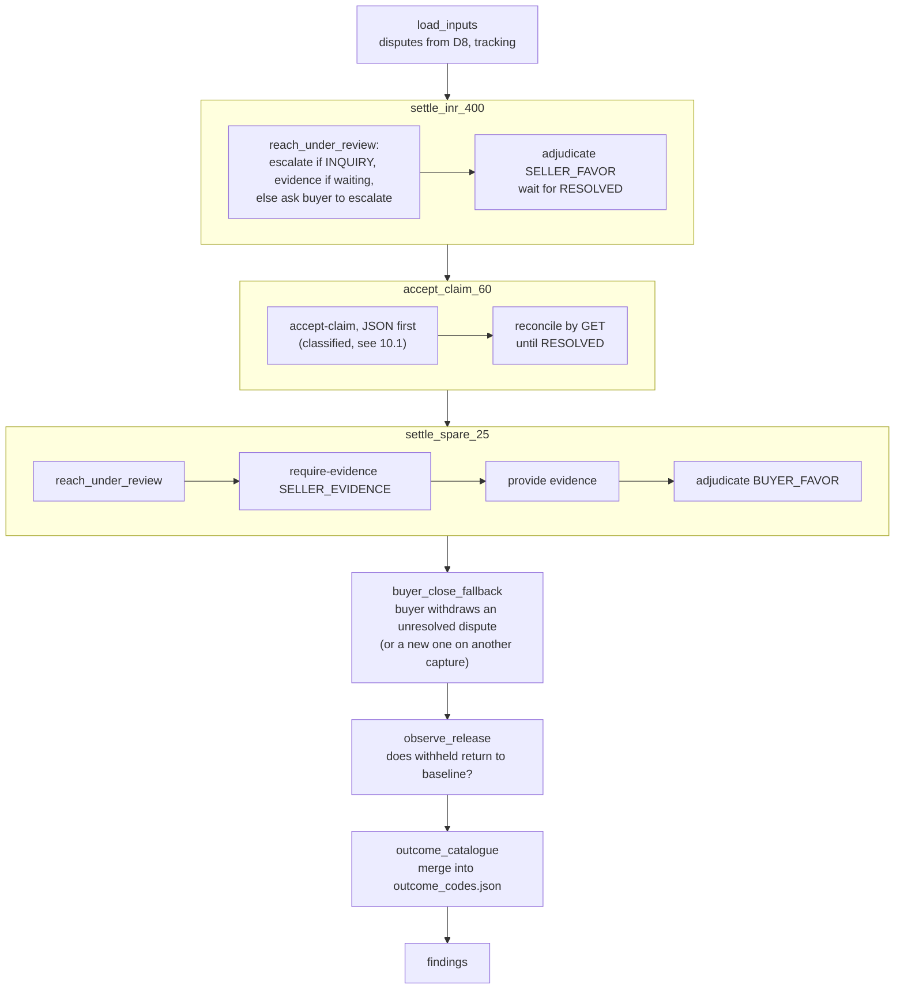

**Verdict:**
- **CONFIRMED** if the $400 dispute was settled by adjudication from UNDER_REVIEW, which is the handoff's claim.
- **DIFFERENT** if anything resolved another way, such as the buyer-close fallback.
- **BLOCKED** if nothing resolved.

**The write-ahead helper `act_once`**, used by every D10 write:

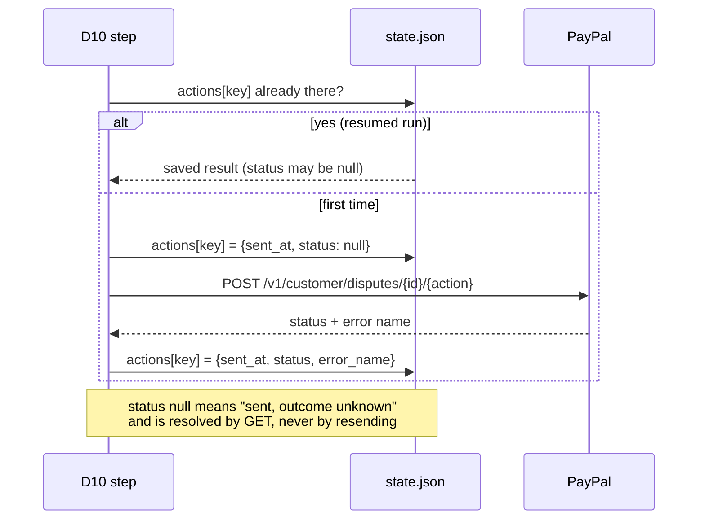

---

## 10. The fixes from Codex's review

Codex reproduced two bugs, and I found a third of the same kind. All three are fixed on `razeef/webhooks-disputes` and covered by regression tests. Before fixing anything, I ran the new tests against the old code to confirm they fail there.

### 10.1 Accept-claim could be sent twice (`c7a531f`)

**Bug:** the JSON accept-claim response is lost (timeout), and the next GET still shows the dispute unresolved because PayPal is slow to update. The old code then tried multipart, which is a **second refund request**.

**Fix:** each attempt is classified, and only a definite format rejection allows the other format:

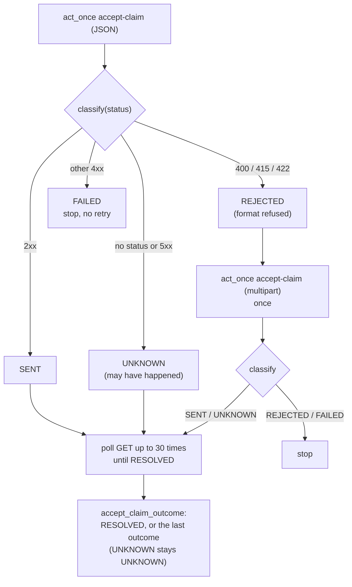

**Tests:**
- A lost response that only becomes visible after 3 stale GETs: exactly **one** POST, outcome RESOLVED. The old code sent 2.
- A lost response that never shows up: one POST, outcome UNKNOWN.
- A JSON 415: falls back to multipart exactly once.

### 10.2 D8 hold evidence

**Bug:** when the balance calls failed or `withheld` was missing, D8 reported `hold_observed: false`, which reads as "PayPal does not hold funds". That is a false finding.

**Fix:** only successful reads that contain a withheld amount count.

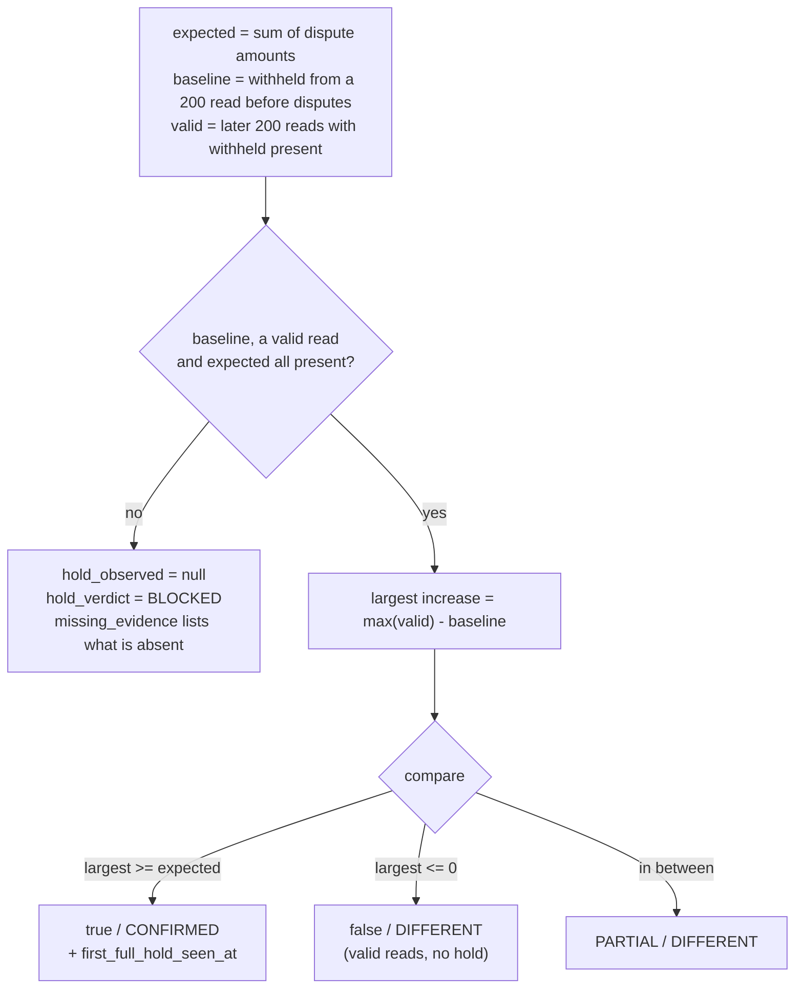

**Tests:**
- all balance calls fail (503);
- `withheld` missing;
- valid reads with no hold (must be DIFFERENT, not BLOCKED);
- failed reads mixed with valid reads that show the hold (must still be CONFIRMED).

The fix commit is `8094006`.

### 10.3 D10 release evidence (`bf55d70`, found while fixing 10.2)

D10 has the same flaw: `withheld_back_to_baseline_at: null` could mean either "never released" or "no usable balance data". It now also reports `release_evidence` (RELEASED, NOT_RELEASED or BLOCKED) and the number of valid reads, and has its own test.

---

## 11. PR #2: the mate's mock PayPal, scenarios and dashboard

**Source:** GitHub PR #2, from `amanxsays`, base `main`. It has 11 commits, all dated Oct 23, and changes 65 files (+20,938 / −7). About 7,500 of those lines are the vendored AG Grid library and its CSS.

**Scope:**
- Cards **M02, M03, M04, M05, M06, M07, M08**, plus three follow-up fixes (M03, M04, M06).
- **Ownership is respected.** Every path is mate-owned: `mock_paypal/`, `eval/`, `web/`, `src/countersign/api/dashboard.py`, `tests/mock_paypal/`, `tests/eval/` and `tests/dashboard/`. No shared files are changed.

### 11.1 Mock PayPal (M01 to M05)

A local FastAPI server (port 8099) that behaves like the parts of PayPal CounterSign uses, with a controllable clock and fault injection. **It never contacts PayPal or reads `.env`.**

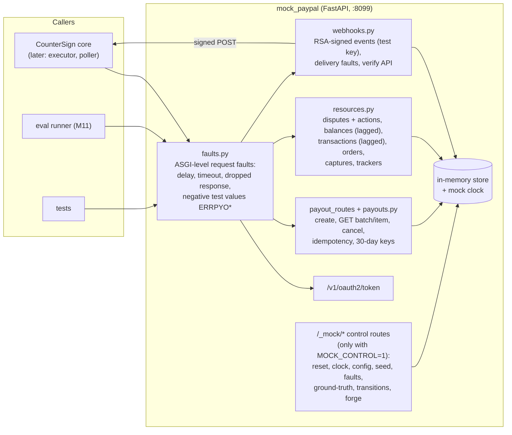

What stands out:
- **Every uncertain PayPal behaviour is a switch, not a guess.**
  - `PayoutBehavior` and `ResourceBehavior` expose each "pending Dn" choice: whether the create response includes item IDs, the cancel status, the duplicate-key error codes, the evidence format, and so on.
  - Nine config flags match CONTRACTS section 5.7, including `unclaimed_counts_in_available`.
  - Once our sandbox recordings exist (C09), M09 flips these switches to the observed behaviour.
- **Lost-response fault:** "dropped response" really sends a partial HTTP body and closes the connection, while the payout stays committed. That is exactly the case our executor must survive (live safety moment 1).
- **Ground truth:** `/_mock/ground-truth` reports what *really* happened (for example, how many payouts exist), so the evaluation can score a system on actual outcomes, not on what the system believes.
- **Webhooks:**
  - Events are signed with a clearly public, test-only RSA key, so signature checks can be tested.
  - Forged events and the duplicate, drop, delay and reorder faults support the `F_webhook_forged` scenario.
- **Money:** amounts are integer minor units, and held refunds consume withheld funds by default (a pending D10 choice).

### 11.2 Scenarios (M08)

`eval/scenario.schema.json` together with `eval/validate.py` define and check a scenario format: initial state, makers, policy, events and expected outcomes, with cross-reference checks. There are six initial scenarios, all marked `provenance: synthesised` and `ground: mock`:

| Scenario | Tests |
| --- | --- |
| `demo_week` | Reserve disputed shares and pay $1,086 once (the HANDOFF demo) |
| `F01_timeout_after_payout_created` | Lost response after PayPal accepted Maker B's payout |
| `F_retry_settled_obligation` | A retry must not pay an already settled obligation |
| `F_unclaimed_cancel_race` | Claim racing a cancel on an UNCLAIMED item |
| `F_webhook_forged` | A forged webhook must not move state |
| `F_injection_refund_other_account` | Prompt injection asking for a refund to another account |

### 11.3 Dashboard API and incident desk (M06, M07)

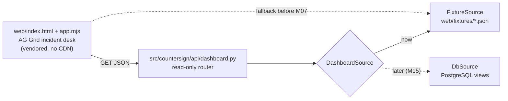

- **Read-only**, with no approval or money buttons (M10 adds those). The banner "Simulated: mock PayPal" cannot be dismissed.
- **Resources:** incidents, proposals, payout runs, makers, disputes, reservations, audit log, cash and money graph. Each one has a JSON schema in `tests/dashboard/schemas/`.
- **Run it** with `python web/serve.py`, then open http://127.0.0.1:8100.

### 11.4 PR #2 verification (run in a scratch copy, nothing changed in the repo)

| Check | Result |
| --- | --- |
| PR #2 alone: `pytest tests` | **190 passed**, 1 known Starlette deprecation warning |
| PR #2 alone: `ruff check` | clean |
| PR #2 alone: `node --test web/tests/*.test.mjs` | **5 passed** |
| Merge into `razeef/sandbox-harness` | no conflicts |
| Merge into `razeef/webhooks-disputes` | no conflicts |
| Combined tree (my branch + PR #2): `pytest` | **271 passed** |
| Combined tree: `ruff check` with the project's config | clean |
| Combined tree: `lint-imports` | 2 kept, 0 broken, but see review item 6 |

---

## 12. Tests and checks

**How the dispute tests work.** No test touches the network. A stateful fake PayPal answers HTTP through httpx's `MockTransport`, a fake clock makes the 3-hour hold observation run instantly, and an `Operator` stands in for the human:

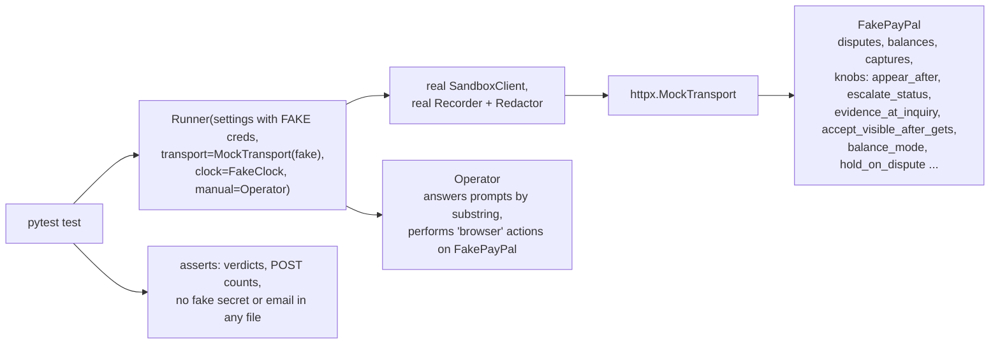

Tests per file on my branch (`razeef/webhooks-disputes`):

| File | Tests | Covers |
| --- | --- | --- |
| `tests/test_smoke.py` | 15 | project layout, import-linter contracts reject unsafe imports |
| `tests/sandbox_checks/test_redact.py` | 9 | redaction of secrets and emails |
| `tests/sandbox_checks/test_recorder.py` | 17 | recordings, raw opt-in, OAuth caching |
| `tests/sandbox_checks/test_runner.py` | 13 | resume, D1 gate, manual steps, poller |
| `tests/sandbox_checks/test_catcher.py` | 10 | exact bytes, duplicates, 500 on failure, registration |
| `tests/sandbox_checks/test_checks_disputes.py` | 17 | D8 to D10 paths and the three fixes |
| `tests/mock_paypal/test_skeleton.py` | 30 | M01 (from `main`) |
| **Total** | **111** | all pass; `ruff check` clean; `lint-imports` 2 kept, 0 broken |

With PR #2 merged in, the total is **271**.

---

## 13. Real sandbox results so far

Only **D1** has run against PayPal (commit `9bc72bb`, Oct 23, 13:40 UTC). The recording is committed in redacted form.

| Required scope | Present |
| --- | --- |
| Payouts (`/payments/payouts`) | yes |
| Disputes read (seller) | yes |
| Disputes update (seller) | yes |
| Reporting (`reporting/search/read`) | yes |
| **Disputes create** (optional) | **yes**, not expected |

- **Verdict: CONFIRMED.** The token lifetime is 32,400 s (9 h).
- **What this changes:** the plan's F5 assumed `disputes/create` needs an account manager and would be missing. Because it is present, **D8 will try the API route** for the $25 spare dispute.
  - That route still needs a buyer consent step and a `PayPal-Auth-Assertion` header.
  - It has never been exercised for real, so it may still fail on permissions. If it does, D8 records BLOCKED with PayPal's error name and opens that dispute through the Resolution Center instead.
- **Findings write-up:** `SANDBOX_FINDINGS.md` does not yet have the D1 row. Filling it in is part of C08, which needs your approval because `docs/` is shared.

---

## 14. Review checklist: open issues and decisions

Ordered by importance.

1. **The fixes are not on Codex's branch.**
   - `95b5630` merged the *old* C06 commits from `origin/razeef/webhooks-disputes`.
   - The accept-claim double-POST fix, the D8 hold fix and the D10 release fix (`c7a531f`, `8094006`, `bf55d70`) exist only on my local branch.
   - **Decision:** cherry-pick those three onto `razeef/sandbox-harness`, or replace the merge with my rewritten branch.
2. **Attribution lines on pushed history.**
   - `2d43d93` (C04) and the old C06 commits `6b3582a`, `b44e1df` and `02e03eb` contain `Co-Authored-By`, and they are now on the remote and in Codex's branch.
   - Removing them means rewriting pushed history and force-pushing two branches.
   - **Decision:** yours (still open from earlier).
3. **My branch has diverged from its pushed copy** (ahead 7, behind 3). Updating the remote needs a force-push, which is the same decision as item 2.
4. **Evidence submission is not write-ahead.**
   - D9's `submit_evidence`, which D10 also uses, tries JSON after *any* non-2xx, including a 5xx.
   - A lost response raises an error, so a resumed run submits again.
   - Evidence moves no money, so I left it that way, but it is inconsistent with the accept-claim rule.
   - **Decision:** align it with `act_once` plus `classify`? It is about 20 lines in C06's files.
5. **F5 is DIFFERENT for this app** (D1 found `disputes/create`). Record it in `SANDBOX_FINDINGS.md` and `DECISIONS.md`. Both are shared files, so this needs your approval.
6. **PR #2: `src/countersign/api/` has no `__init__.py`.**
   - Import-linter therefore analyses only `countersign/__init__.py` ("Analyzed 1 files"), and the import contracts do not cover `api/dashboard.py` yet.
   - It imports nothing forbidden today, but the guard should see it.
   - Per AGENTS.md, `api/` except `dashboard.py` belongs to core, so core should add the empty file. The mate should not.
7. **PR #2 is based on `main`, which has no `pyproject.toml` yet.** It passes against the project config only once combined with the C01 skeleton (verified above). Merge order into `main`: core's skeleton first, or both together.
8. **C05 (D2 to D7) and C07 (D11 to D13) are not built.**
   - D8 to D10 work without D2, but ask for capture IDs and tracking by hand.
   - D11 is the only place webhook signatures get verified.
9. **D8 is long and manual.**
   - The hold observation runs 3 hours of wall time (resumable).
   - Finding disputes allows up to 1 hour each.
   - Plan a session where the buyer browser steps can be done.
10. **PR #2 vendors AG Grid** (about 7,500 lines, MIT licence included). This is intentional (no CDN at run time), but it inflates diffs.

---

## 15. How to run things

All commands run from the repository root, with the project venv.

```powershell
# checks (core)
.venv\Scripts\python.exe -m pytest
.venv\Scripts\python.exe -m ruff check .
.venv\Scripts\lint-imports.exe

# run a sandbox check (reads .env at run time; prints nothing secret)
.venv\Scripts\python.exe -m scripts.sandbox_checks run D1
.venv\Scripts\python.exe -m scripts.sandbox_checks run D8            # resumes if interrupted
.venv\Scripts\python.exe -m scripts.sandbox_checks run D8 --fresh    # restart steps, keep evidence

# webhook catcher (owner starts ngrok separately)
.venv\Scripts\python.exe -m uvicorn scripts.sandbox_checks.catcher:app --port 8000
.venv\Scripts\python.exe -m scripts.sandbox_checks.register_webhook --url https://<tunnel>/webhooks/paypal --dry-run

# mate's mock and desk (PR #2)
$env:MOCK_CONTROL = "1"; .venv\Scripts\python.exe -m mock_paypal       # http://127.0.0.1:8099
.venv\Scripts\python.exe web\serve.py                                  # http://127.0.0.1:8100
node --test web/tests/*.test.mjs
.venv\Scripts\python.exe -m eval.validate
```

---

## 16. Glossary

| Term | Meaning |
| --- | --- |
| **CONFIRMED / DIFFERENT / BLOCKED** | Check verdicts: the handoff's claim holds; PayPal behaves differently (design change needed); could not be tested (recorded, not chased). |
| **UNKNOWN** | A write was sent but its outcome is not known, for example after a lost response. Resolved by reading (GET), never by sending again. |
| **Write-ahead** | Save "about to send X" *before* sending, so a crash can never lead to a blind resend. |
| **Staged** | A sandbox action a person or script performs to create test conditions (buyer opens a dispute, script accepts a claim). Labelled as such everywhere. |
| **Hold / withheld** | Money PayPal keeps back while a dispute is open, read from `/v1/reporting/balances`. |
| **HATEOAS rel** | The `links[].rel` names in a PayPal response, which say which actions are allowed now (for example `provide_evidence` or `escalate`). |
| **Pending Dn** | A design choice that depends on day one check Dn. The mock keeps it as a switch until the recording settles it. |
| **F1 to F18** | Handoff review findings in `PLAN.md` section 3. |
| **core / mate** | The two owners from AGENTS.md. Core is you with Codex and me; mate is amanxsays. |
