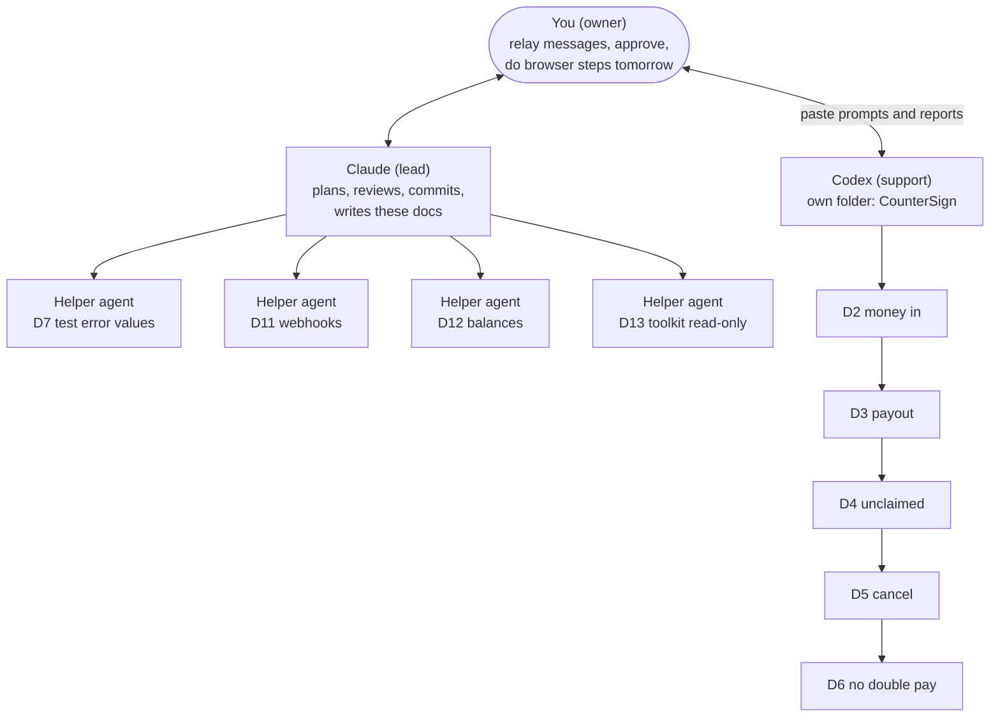

# Today's plan (Oct 23): finish the day one code

## The goal in one line

Have **all 13 sandbox checks written and tested** today, so that tomorrow (Oct 24) and Oct 25 are only about *running* them against PayPal and writing down what we saw.

## Who does what

## Why this order

- **D2 comes first.** It creates the three test payments ($400, $60, $25) that the dispute checks D8 to D10 need, and D8 alone takes about 3 hours to watch the balance. So D2 must be ready first thing tomorrow.
- **D7, D11, D12 and D13 don't depend on D2's code**, so the helper agents build them at the same time.
- **Two folders, one repository.** Codex works in `CounterSign`, and Claude and the helpers work in `CounterSign-webhooks` (a git *worktree*). Neither side can overwrite the other's files. At the end of the day the work is merged into one branch, and the second folder is removed with `git worktree remove`.

## What "done today" means

1. Every check from D1 to D13 has code and tests, and the tests pass, using a **fake PayPal** (no real calls today).
2. `ruff`, `pytest` and the import rules are green on the merged branch.
3. Each check has an easy explanation page in this folder.
4. A short "run sheet" for tomorrow: which check to run when, and what you will click in the browser.

## What stays for tomorrow (needs you)

- **Before D2 runs:**
  - start ngrok and the webhook catcher;
  - register the webhook;
  - put the webhook ID in `.env`.
- **During the run:**
  - approve the 3 payments as the test buyer;
  - open the disputes in the Resolution Center when D8 asks.
