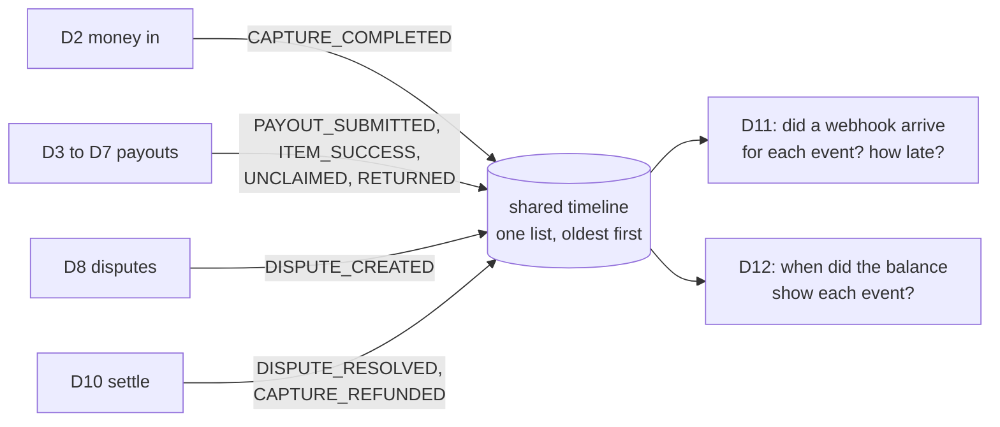

# Step 1: the shared timeline ("what happened when")

**Commit:** `6b83518`. **File:** `scripts/sandbox_checks/timeline.py`.

## What problem it solves

Two of our checks are *analysis* checks: they don't do anything new at PayPal, they compare things.

- **D11 (webhooks)** asks: "For every change we saw at PayPal, did PayPal also send us a webhook? How late was it?"
- **D12 (balances)** asks: "After a payment or a dispute, how long until the balance shows it?"

Both need one list of **what happened, to which payment or dispute, and when**. Without it they would have to dig through every other check's data in its own format.

## How it works

Every check that sees a change at PayPal adds one line to its own timeline, for example:

| at (when we saw it) | source | event | resource | amount |
| --- | --- | --- | --- | --- |
| 10:02 | D2 | CAPTURE_COMPLETED | capture `5TY…` | $400.00 |
| 10:15 | D3 | PAYOUT_SUBMITTED | batch `XYZ…` | $1.00 |
| 13:40 | D8 | DISPUTE_CREATED | dispute `PP-D-…` | $400.00 |
| 16:05 | D10 | DISPUTE_RESOLVED | dispute `PP-D-…` | $400.00 |

The helper also knows, for each kind of event:
- **which webhook should announce it.** For example, a completed capture should bring `PAYMENT.CAPTURE.COMPLETED`.
- **which balance should move, and in which direction.** For example, a new dispute should raise the *withheld* balance.

## Safe by design

- **No duplicates.** If a check is interrupted and resumed, the same event is never added twice.
- **Saved immediately.** Each entry is written to disk as soon as it's added, so nothing is lost on a crash.
- **Typo-proof.** Only the known event names are allowed, so a typo fails a test instead of silently creating a new kind of event.

## Tested

3 tests: it records once, merges all checks in time order, and rejects unknown events.
