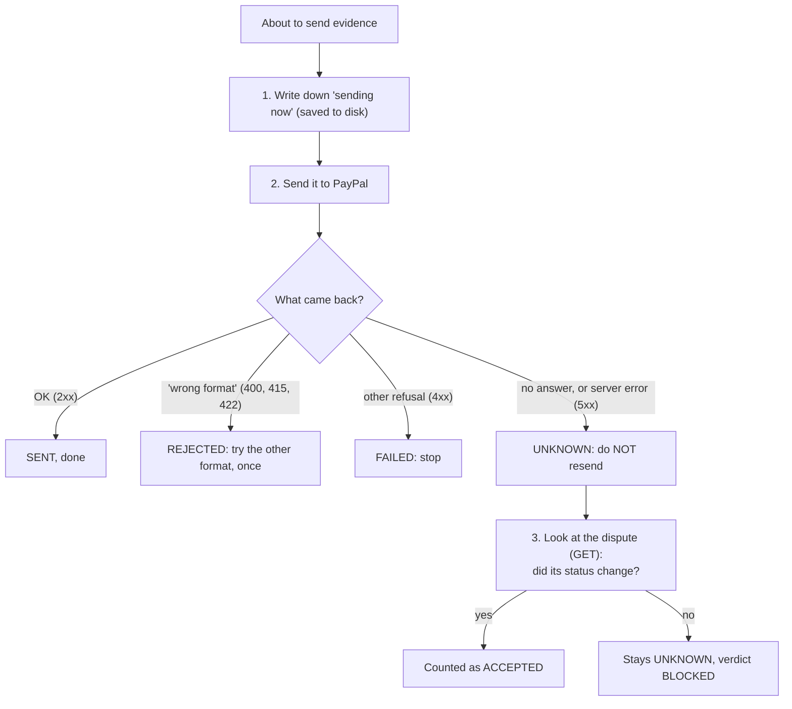

# Step 2: dispute evidence is never sent twice

**Commit:** `e524df1`. **Files:** the dispute checks D8, D9 and D10, plus their tests.

## The problem

When a buyer says "I never got my item", we answer the dispute with **evidence**: the tracking number. Check D9 sends it to PayPal. PayPal's docs disagree on the format, so we try two: first *multipart* (a form upload), then plain *JSON*.

The old code had a weakness. If the network dropped **after** PayPal received the evidence but **before** we got the answer, then:
- the check stopped; when we ran it again, it sent the evidence **a second time**;
- and on any error, even a PayPal server error, it immediately tried the second format, which is a third send.

That doesn't move money, but it can confuse the dispute and spoil the experiment, because we would no longer know which upload PayPal reacted to.

## The fix, in plain words

We now treat evidence exactly like the refund action in D10:

**In short:** we only try the other format when PayPal clearly says "I don't understand this format". When we don't know what happened, we **look**; we never send again.

## Also in this step

- **D8** now adds every dispute it finds to the [shared timeline](02-shared-timeline.md) as `DISPUTE_CREATED`, with the amount.
- **D10** adds `DISPUTE_RESOLVED` when a dispute closes, and `CAPTURE_REFUNDED` when the buyer got money back.
- So D11 and D12 can check the matching webhooks and balance changes.

## How we know it works

- **Lost answer after PayPal took the evidence:** exactly **1** upload, and on resume the check looks instead of resending. Verdict: CONFIRMED.
- **PayPal server error:** 1 upload, no second format, verdict BLOCKED (we don't pretend to know).
- **PayPal says "wrong format":** the other format is tried exactly once.
- **Full D8 to D10 run:** all three disputes show as created and resolved on the timeline, with refunds of $60 and $25.
- **The old code fails the first test:** it sent the evidence **2** times. That's the bug we fixed.

All 24 dispute and timeline tests pass, and `ruff` is clean.
