# Run sheet: running the day one checks (Oct 24 and 25)

All 13 checks are built and tested with a fake PayPal. Now they run against the **real sandbox**. This page says what to start, in which terminal, and when you're needed.

**Golden rules**
- **Run everything from the `CounterSign` folder.** That's where `.env` lives; the `CounterSign-webhooks` folder has no `.env`.
- **If a check stops** (Ctrl+C, network, laptop sleep), run the **same command again** and it continues where it stopped. If the date has changed since it started, add `--date 2026-10-24`.
- **Never use `--fresh` on a check that already sent payments or disputes** unless Claude says so.
- **Every command below** starts with `$env:PYTHONPATH = "src"` in that terminal (once per terminal).

## Before you start (about 15 minutes)

1. **Make sure the `CounterSign` folder has all the work.** Codex must have cherry-picked Claude's last five commits (D7, D11, D12, D13 and these docs). Check with `git log --oneline -15` that you see the `C07: ...` commits. If they're missing, send Codex the integration prompt first.
2. **Check `.env`** has the buyer, maker A, maker B and the three never-registered emails (`SBX_UNREG_EMAILS`). Don't paste it anywhere.
3. **Terminal T1, webhook catcher:**
   ```powershell
   .venv\Scripts\python.exe -m uvicorn scripts.sandbox_checks.catcher:app --port 8000
   ```
4. **Tunnel:** keep your existing ngrok tunnel pointing to port 8000. If the webhook is **not** registered yet:
   ```powershell
   .venv\Scripts\python.exe -m scripts.sandbox_checks.register_webhook --url https://<your-ngrok-host>/webhooks/paypal --dry-run
   .venv\Scripts\python.exe -m scripts.sandbox_checks.register_webhook --url https://<your-ngrok-host>/webhooks/paypal
   ```
   Put the printed ID into `PAYPAL_WEBHOOK_ID` in `.env` yourself. If a webhook already exists for this URL, skip this step: don't change the existing endpoint.

## The order (Oct 24)

```mermaid
gantt
    title Oct 24 to 25 sandbox runs (approximate)
    dateFormat HH:mm
    axisFormat %H:%M
    section T2 main
    D2 money in (you approve 3 payments)    :d2, 09:00, 20m
    D3 payout                               :d3, after d2, 20m
    D4 unclaimed                            :d4, after d3, 40m
    D7 test error codes                     :d7, after d4, 15m
    D13 toolkit read-only                   :d13, after d7, 20m
    D6 no double pay                        :d6, after d13, 40m
    section T3
    D12 balances (waits all day)            :d12, after d2, 600m
    section T4 disputes
    D8 open disputes + 3h hold watch        :d8, after d2, 270m
    D9 evidence                             :d9, after d8, 20m
    D10 settle (you help as buyer)          :d10, after d9, 120m
    section T5
    D5 cancel + watch until Oct 25 night    :d5, after d4, 600m
```



| When | Terminal | Command (`run Dn` means `.venv\Scripts\python.exe -m scripts.sandbox_checks run Dn`) | What **you** do |
| --- | --- | --- | --- |
| 1. First | T2 | `run D2` | Open each approval link, log in as **buyer-1**, approve; press Enter. Type a test carrier (e.g. `USPS`) and tracking number when asked. |
| 2. Right after D2 | T3 | `run D12` | Nothing now. **Leave it open all day.** Press Enter only after D10 finishes. |
| 3. Right after D2 | T4 | `run D8` | Log in as buyer-1 at the Resolution Center link it prints, report a problem on each payment it names, press Enter after each. Then it watches the balance for 3 hours on its own. |
| 4. Meanwhile | T2 | `run D3`, then `run D4`, `run D7`, `run D13`, `run D6` | Normally nothing. If one asks to confirm an "identical replay", read it and press Enter. |
| 5. After D4 | T5 | `run D5` | Answer **no** to the optional unreg-3 claim test unless you want it. **Leave it open**: it keeps checking until Oct 25, 23:59 IST. |
| 6. After D8 finishes | T4 | `run D9` | Nothing (it sends the tracking evidence). |
| 7. After D9 | T4 | `run D10` | When asked, as buyer-1: escalate a case to PayPal, or close or cancel one (the fallback). Type `skip` if it asks for an extra payment and you don't want one. |
| 8. After D10 | T3 | press **Enter** in the D12 window | D12 builds its balance table. |
| 9. Last | T2 | `run D11` | Confirm the catcher and tunnel are still running; press Enter once. |

## After the runs (Oct 25)

- Send Claude the list of `findings.json` verdicts (from `recordings/sandbox/<date>/Dn/findings.json`). Claude fills `docs/SANDBOX_FINDINGS.md`, proposes the `DECISIONS.md` lines for every DIFFERENT, and runs the secret check over `recordings/sandbox/` before anything is committed.
- **Commit only redacted recordings.** `recordings/sandbox/raw/` is gitignored on purpose; never force-add it.

## If something looks wrong

| You see | Meaning | Do |
| --- | --- | --- |
| `... stopped at <step> (<ErrorType>); progress is saved.` | A call failed. | Run the same command again. |
| `Write outcome UNKNOWN; resume with saved keys` | A payout's answer was lost. | Run the same command again; it repeats the *identical* request, which PayPal treats as the same payout. |
| `D1 must be CONFIRMED` | You are not in the `CounterSign` folder, or the D1 recording is missing. | `cd` into `CounterSign`. |
| A `WARNING ... real $1.00 sandbox payout` from D7 | PayPal ignored a test code. | Nothing; it's recorded, and D7 stopped further creates. Mention it to Claude. |
