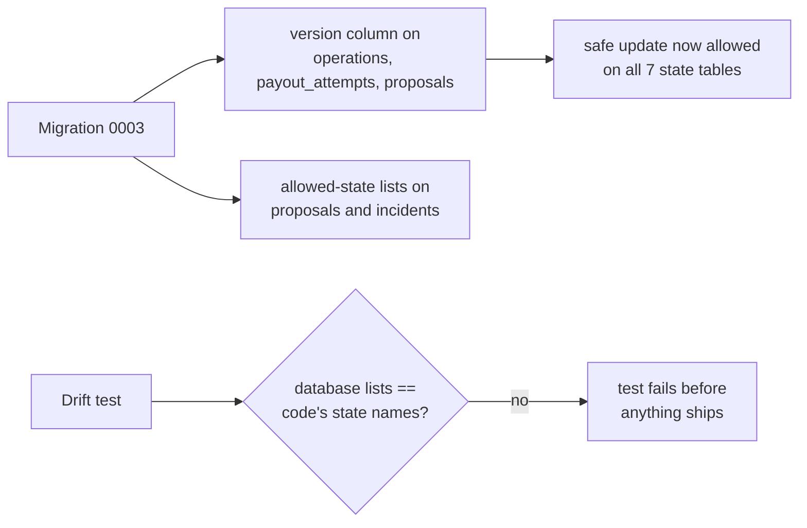

# Step 18: closing a gap between the database and the state machines

**Commit:** `da027ac` (migration `0003_state_guards`). **Who:** Claude, after reviewing Codex's C11 and C12.

## The problem

CounterSign never changes a row with a plain "set state to X". It uses a **safe update** (compare-and-set): "change this payout from PREPARED to SUBMITTED, **but only if** it is still PREPARED and nobody else has touched it since I read it (same version number)". If two workers race, exactly one wins and the other gets an error instead of a silent double write.

That needs a `version` number on the row. The original schema plan gave one to obligations, payout lines, runs and incidents, but **not** to three tables where a race matters most:

| Table | What a race could do without a version |
| --- | --- |
| `operations` | Two workers both mark the same PayPal write as "sent" |
| `payout_attempts` | Two workers both move the same payout attempt |
| `proposals` | An owner-approved proposal executed twice |

Proposals and incidents also had **no list of allowed states** in the database, so a typo like `"EXECUTD"` could have been saved.

## The fix

- **A small migration** adds the missing version numbers and allowed-state lists. It can be undone (`alembic downgrade 0002`).
- **The safe-update helper** now accepts all seven state tables. Disputes stay excluded on purpose: PayPal owns their status, and we only mirror it.
- **A new "drift test"** reads the database migration files and checks, table by table, that the allowed states are exactly the state names in the code. It also checks that the "only one live payout attempt per line" rule covers exactly the live states. If anyone changes one side without the other, the tests fail.

## Tested

- 1,274 tests pass, including 53 against a real PostgreSQL 16 in Docker.
- The import safety rules hold.
- The reasons are recorded in `docs/DECISIONS.md`.
