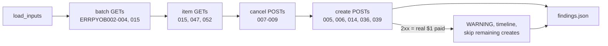

# C05 / D7: Payouts negative-test values

## 1. What this check proves

PayPal's sandbox can fake specific Payouts failures when you send a magic "test value" such as `ERRPYO005`. D7 sends each of the 14 values our plan relies on and records exactly what PayPal answers: the HTTP status, the error `name`, the `debug_id` and the full body. Those recordings replace the guesses in the mock PayPal's fault harness (`mock_paypal/faults.py`, `NEGATIVE_VALUES`), so our failure tests copy real PayPal behaviour.

## 2. What you (the owner) will do

Nothing during the run: there are no browser steps. You need:

- D1 already CONFIRMED (every check except D1 requires it).
- `SBX_MAKER_B_EMAIL` set in `.env` (maker B's sandbox email). Without it, the five "create payout" values are skipped and D7 ends BLOCKED.

Afterwards, read `findings.json`. If it lists anything under `money_moved` or `unknown_creates`, PayPal may have sent real sandbox money ($1.00 each) to maker B. That is harmless in the sandbox, but tell the lead so D12's balance analysis accounts for it.

## 3. What the script does, step by step

The source of every trigger is PayPal's page <https://developer.paypal.com/api/payouts/v5/standard/test-go-live/>, which says: "use a JSON pointer in the request payload or use a path parameter in the request URI".

1. **load_inputs**: notes whether maker B's email is configured and lists the 15 probes it will send.
2. **batch_values**: `GET /v1/payments/payouts/ERRPYOB002` (then `B003` and `B004`). The value goes where a batch ID normally goes. PayPal should answer with batch status PENDING, PROCESSING or DENIED. It also tries `GET /v1/payments/payouts/ERRPYO015`, because PayPal's own example puts that value on this path.
3. **item_values**: `GET /v1/payments/payouts-item/ERRPYO015` (and `047`, `052`), with the value in place of an item ID. The plan expected CLOSED_MARKET, RECEIVER_UNREGISTERED and RISK_DECLINE here. The docs list ERRPYO015 under the batch call, not the item call, so D7 tries both paths and records which one works.
4. **cancel_values**: `POST /v1/payments/payouts-item/ERRPYO007/cancel` (and `008`, `009`). No real item exists, so no money can move. Expected: ITEM_ALREADY_CANCELLED, ITEM_CANCELLATION_FAILED, ITEM_INCORRECT_STATUS.
5. **create_values** (last, on purpose): five `POST /v1/payments/payouts` calls, each a $1.00 payout to maker B with the test value in `items[0].note` and fresh `cs-<uuid7>-a1` keys. Expected: INSUFFICIENT_FUNDS, INTERNAL_ERROR, USER_BUSINESS_ERROR, REQUEST_TIMEOUT_EXCEEDED, PREVIOUS_REQUEST_IN_PROGRESS.
   - Each request is saved to disk *before* it is sent.
   - If PayPal ignores a value and really pays (HTTP 2xx), D7 prints a WARNING with the batch ID, adds the payout to the shared timeline, never retries it, and skips the remaining create values so no more money moves.
   - If the response is lost (timeout or broken connection), the value is UNKNOWN. It is never sent again, not even after a restart.
6. **findings**: compares each answer with the documented name and writes `findings.json`.



## 4. What gets saved, and where

All under `recordings/sandbox/<date>/D7/`, with tokens, client ID and secret removed and maker B's email replaced by `maker-b@redacted`:

- `NN_<operation>_<value>.json`: one raw HTTP exchange per probe (method, path, headers without Authorization, both bodies, `paypal-debug-id`, send and receive times).
- `state.json`: progress, plus one entry per probe under `probes` (`create:ERRPYO005`, `get_batch:ERRPYOB002` and so on) with `value, operation, expected_name, status, error_name, debug_id, matched`, the trigger used, the mock's current guess (`mock_status`) and the response body. Create probes also keep their keys and request body.
- `findings.json`: the verdict; a per-value summary (`values`, with `matched_on` saying which path worked); every probe; `fixtures` (the status and name to paste into the mock); `mismatched_values`, `unknown_values`, `money_moved`, `unknown_creates` and `notes`.
- If real money moved: a `PAYOUT_SUBMITTED` entry in D7's `timeline`, which D11 and D12 read.

## 5. How the verdict is decided

A value "matches" when the documented name appears anywhere PayPal normally puts a name: the error `name`, an item's `errors.name`, the batch status or the transaction status.

- **CONFIRMED**: every one of the 14 values returned its documented name.
- **DIFFERENT**: a create was really paid (always DIFFERENT, loudly), or at least one value returned some other name.
- **BLOCKED**:
  - no value got any response; or
  - nothing matched and every answer was the same error (most likely negative testing is not active for this account; the note says so); or
  - nothing contradicted the docs, but some values have no answer (a lost response, or creates skipped because maker B's email is missing). Missing evidence is never counted as "PayPal behaves differently".

## 6. How to run it

From the repository root, with D1 already CONFIRMED:

```powershell
$env:PYTHONPATH = "src"
.venv\Scripts\python.exe -m scripts.sandbox_checks run D7
```

If it stops halfway, run the same command again (add `--date YYYY-MM-DD` if the UTC date has changed since the first run). It continues where it stopped, and a create that may already have reached PayPal is marked UNKNOWN instead of being resent. The tests run with fake PayPal responses and no network:

```powershell
.venv\Scripts\python.exe -m pytest -q -p no:cacheprovider tests/sandbox_checks/test_check_d07.py
```
