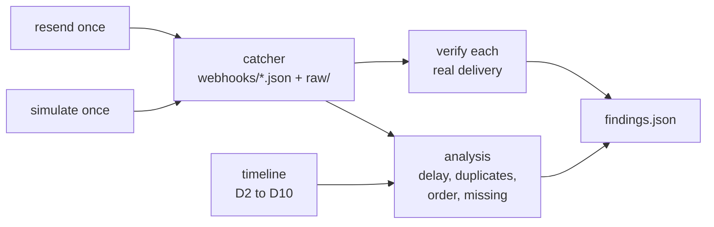

# C07 / D11: Webhooks (timing, gaps and signatures)

## 1. What this check proves

The handoff says: "webhook authenticity via the verify API; deliveries can be late, duplicated or missing." D11 asks PayPal to verify the signature of every real webhook the catcher stored. It also measures how late, duplicated, out of order or missing those webhooks were, compared with what the other checks saw by polling. Finally, it sends one simulator event and resends one real event, to test two things the product may rely on: backfill and duplicate deliveries.

## 2. What you (the owner) will do

- Before you start: D1 is CONFIRMED, `PAYPAL_WEBHOOK_ID` is set in `.env`, and the webhook catcher and its HTTPS tunnel ran during the other checks (D2 to D10), so that deliveries exist in `recordings/sandbox/webhooks/`.
- During the run: press Enter once, when D11 asks you to confirm that the catcher (`uvicorn scripts.sandbox_checks.catcher:app --port 8000`) and the tunnel are still running. It needs them to catch the simulator event and the resent event.
- Nothing else. There are no browser steps and no money moves.

## 3. What the script does, step by step

1. **inputs**: counts the stored deliveries, notes whether the webhook ID is set, and remembers which deliveries existed before D11 started.
2. **list_events**: `GET /v1/notifications/webhooks-events?page_size=50` (read only). It records whether this works, and lists events PayPal says it sent that never reached the catcher. If it works, the reconciliation poller can use it to backfill missed webhooks.
3. **simulate_event**: asks you to confirm that the catcher is running, saves a checkpoint, then sends `POST /v1/notifications/simulate-event` once with `{"webhook_id": ..., "event_type": "PAYMENT.CAPTURE.COMPLETED"}`. If the run stops after this point, the event is never sent again.
4. **await_simulated**: checks the webhooks folder every 10 seconds, for up to 5 minutes, until the simulated event arrives. Then it asks PayPal to verify the event's signature. PayPal's docs say this should FAIL, because simulator events carry the placeholder webhook ID `WEBHOOK_ID` (finding F11).
5. **resend_event**: picks the earliest real delivery, saves a checkpoint, then sends `POST /v1/notifications/webhooks-events/{event_id}/resend` once with `{"webhook_ids": [your webhook ID]}`. It is never sent again.
6. **await_resent**: waits (same 5-minute limit) for the resent copy. If it arrives, resend works and can be used to create duplicate-delivery faults on purpose.
7. **analysis**: reads every stored real delivery and the shared timeline (what D2 to D10 saw by polling):
   - **delay**: `received_at` minus PayPal's `create_time`, per delivery, with min, median and max per event type;
   - **duplicates**: the same event ID delivered more than once (the resend's copy is labelled `induced_by_resend`);
   - **order**: for each resource (payout item, payout batch, capture, dispute), a delivery whose `create_time` is earlier than one already received;
   - **missing**: timeline events for which no expected webhook arrived for that resource (for example, a dispute D8 saw open with no `CUSTOMER.DISPUTE.CREATED`). It also records how many seconds the webhook arrived before or after polling saw the change.
8. **verify_signatures**: for every real delivery, `POST /v1/notifications/verify-webhook-signature` with the five `paypal-*` headers the catcher saved, your webhook ID, and the event parsed from the exact stored bytes. Each result is saved as soon as it arrives, so a resumed run skips deliveries that already have SUCCESS or FAILURE.
9. **findings**: writes `findings.json`.



How the script finds the resource each webhook is about (from PayPal's resource schemas; the webhook docs show no sample payloads, so this is still marked [pending D11]):

| Webhook family | Resource ID field |
| --- | --- |
| `PAYMENT.PAYOUTS-ITEM.*` | `resource.payout_item_id` |
| `PAYMENT.PAYOUTSBATCH.*` | `resource.batch_header.payout_batch_id` |
| `PAYMENT.CAPTURE.*` | `resource.id`; for a refund, also the capture ID in its `up` link |
| `CUSTOMER.DISPUTE.*` | `resource.dispute_id` |

## 4. What gets saved, and where

Under `recordings/sandbox/<date>/D11/`, with the token, client ID and secret removed and emails replaced:

- `NN_list_events.json`, `NN_simulate_event.json`, `NN_resend_event.json`, `NN_verify_signature.json`: one redacted HTTP exchange per call.
- `state.json`: progress, plus `simulator`, `resend`, `event_list`, `analysis` and `verifications` (one entry per delivery name: HTTP status, `verification_status`, error type).
- `findings.json`: the verdict and reason, the signature summary (success, failure, unknown and the names of each), the simulator and backfill results, the full analysis, and notes.

D11 only reads the catcher's files (`recordings/sandbox/webhooks/` and the gitignored `recordings/sandbox/raw/webhooks/`). The simulated and resent events land there like any other delivery.

## 5. How the verdict is decided

Only real deliveries count. Simulator events are reported separately: FAILURE is expected for them.

- **CONFIRMED**: every real delivery verified SUCCESS.
- **DIFFERENT**: at least one real delivery returned FAILURE.
- **BLOCKED**:
  - `PAYPAL_WEBHOOK_ID` is not set (nothing is sent at all); or
  - there are no stored real deliveries; or
  - no delivery failed, but some could not be verified. A verify call with no answer, a 5xx, a non-SUCCESS/FAILURE reply, missing signature headers or missing raw files is "unknown", never a FAILURE.

The delay, duplicate, order and missing statistics are reported whatever the verdict. They describe how PayPal behaves; they do not change the verdict.

One known limit is recorded in the notes: the verify API takes the event as JSON, so PayPal checks a re-serialised event, not the exact bytes we received. The raw bytes are kept, but this check does not solve the exact-bytes question.

## 6. How to run it

Run it last, after D2 to D10, from the repository root:

```powershell
$env:PYTHONPATH = "src"
.venv\Scripts\python.exe -m scripts.sandbox_checks run D11
```

If it stops halfway, run the same command again (add `--date YYYY-MM-DD` if the UTC date has changed). It continues where it stopped, never sends the simulator event or the resend twice, and only re-verifies deliveries that have no answer yet. Do not use `--fresh` unless you want a second simulator event and a second resend.

Tests (fake PayPal, no network):

```powershell
$env:PYTHONPATH = "src"
.venv\Scripts\python.exe -m pytest -q -p no:cacheprovider tests/sandbox_checks/test_check_d11.py
```
