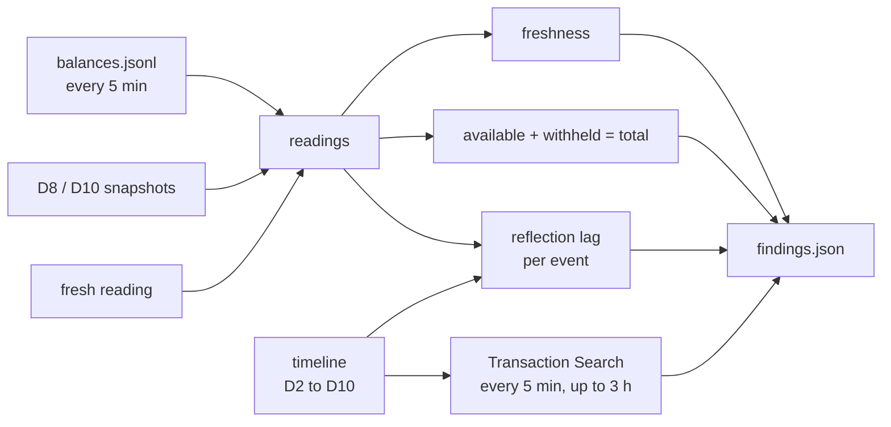

# C07 / D12: Balance freshness

## 1. What this check proves

The handoff says "balances can lag up to 3 hours". D12 measures how old PayPal's balance figures are when we read them, whether available + withheld always adds up to total, and how long each money event seen by D2 to D10 (a capture, a payout, a dispute hold, and so on) takes to show up in a balance. It also measures once how long a capture takes to appear in Transaction Search.

## 2. What you (the owner) will do

- Before you start: D1 is CONFIRMED. D12 reads what the other checks left behind, so it is most useful after D2 to D10 have run (or at least D2 and D8).
- **During the run:** press Enter **once**, when D12 says "press Enter once D10 has finished". There are no browser steps and no money moves; D12 only sends GET requests.
- **Timing:** start D12 right after D2's first capture and leave its window open all day (see section 6). It can only time the Transaction Search if it starts within about 3 hours of that capture.

## 3. What the script does, step by step

1. **fresh_balance**: one `GET /v1/reporting/balances?currency_code=USD` of its own, so every run has at least one reading.
2. **poll_transactions**: finds the earliest `CAPTURE_COMPLETED` event in the shared timeline. Every 5 minutes, for up to 3 hours, it calls `GET /v1/reporting/transactions` with `transaction_id` = that capture ID, `start_date` = one day before the capture, `end_date` = now (always within the documented 31-day limit), and `fields=transaction_info`. It stops as soon as the capture appears. Each call is saved as it happens, so a stopped run resumes where it left off. If there is no capture in the timeline, this part is BLOCKED and nothing is sent.
3. **wait_for_settlement**: prints "press Enter once D10 has finished" and waits. Meanwhile the runner's balance poller keeps writing a reading every 5 minutes, so the balance history covers D3 to D10 too.
4. **findings**: gathers every balance reading:
   - the runner's own `recordings/sandbox/balances.jsonl` (one line every 5 minutes during every check, including D12's 3 hours of polling);
   - D8's `baseline_balance` and `hold_observations`, and D10's `release_observations`;
   - D12's fresh reading.

   A reading is **valid** when PayPal answered HTTP 200 with at least one balance amount. It then works out four parts:
   - **Freshness**: for every valid reading, the time we fetched it minus PayPal's `last_refresh_time`, and minus `as_of_time`. It reports the count, min, median, max, and how many exceed 3 hours.
   - **Consistency**: per reading and currency, whether available + withheld = total, in whole cents. It counts mismatches and keeps up to five examples.
   - **Reflection lag**: for each timeline event that should move a balance (see the table below), it takes the last valid reading at or before the event as the baseline. It then finds the first later reading where that balance moved the right way by at least half the event's amount (half, because PayPal fees make a capture's net amount smaller than its gross). The lag is that reading's time minus the event time. The previous valid reading that did not show it gives a lower bound.
   - **Transactions lag**: when the capture first appeared, relative to the event time.
4. Writes `findings.json`.

| Timeline event | Balance that should move |
| --- | --- |
| `CAPTURE_COMPLETED` | available goes up |
| `CAPTURE_REFUNDED` | available goes down |
| `PAYOUT_SUBMITTED` | available goes down |
| `PAYOUT_ITEM_FAILED`, `PAYOUT_ITEM_RETURNED` | available goes up |
| `DISPUTE_CREATED` | withheld goes up |
| `DISPUTE_RESOLVED` | withheld goes down |

Payout SUCCESS, UNCLAIMED and dispute updates move no balance, so they are skipped.

What each event row can say:

- **REFLECTED**: with the lag in seconds and its lower bound.
- **NOT_REFLECTED**: no valid reading showed it, and valid readings continued for more than 3 hours after the event.
- **BLOCKED**: there is not enough evidence to call it either way. This happens when there was no valid reading before the event, no valid reading after it, or valid readings stop within 3 hours of it. It also happens when an opposite event on the same balance (a dispute created and then resolved, say) could have cancelled the movement out. Failed reads are never treated as "not reflected".

Events that happened in the same window are listed under `overlapping_events`, because the balance change may belong to the other event.



## 4. What gets saved, and where

Under `recordings/sandbox/<date>/D12/`, with the token, client ID and secret removed and emails replaced:

- `NN_fresh_balance.json` and `NN_transaction_search.json`: one redacted HTTP exchange per call.
- `NN_balance_snapshot.json`: the runner's own 5-minute balance reads. These also go into `recordings/sandbox/balances.jsonl`.
- `state.json`: progress, plus `fresh_balance`, `transactions_capture` (which capture is being timed) and `transaction_polls` (one entry per search: time, HTTP status, found or not).
- `findings.json`: the verdict, a verdict for each part, reading counts by source, the freshness statistics, the consistency counts with examples, one row per event (baseline, reflecting reading, lag, overlaps, or the reason it is blocked), a summary by event type, the transactions result, and notes on the method's limits.

## 5. How the verdict is decided

Each part gets its own verdict (`part_verdicts`), and the overall verdict comes from those:

- **DIFFERENT** if any of these is true:
  - a reading was more than 3 hours old;
  - available + withheld did not equal total;
  - an event took more than 3 hours to show up (its lower bound is over 3 hours) or never showed up within 3 hours of valid readings;
  - Transaction Search still did not show the capture more than 3 hours after it.
- **BLOCKED**: there are no valid readings, or no reading carried a usable `last_refresh_time` or `as_of_time`.
- **CONFIRMED**: otherwise. Parts that had no evidence (for example, no capture in the timeline) are listed in `blocked_parts`, so a CONFIRMED result shows which parts it rests on.

The transactions part is only CONFIRMED when the capture appeared within 3 hours of it. If the capture was already visible on the first search and that search came more than 3 hours after the capture, the lag is only known as an upper bound, and that part is BLOCKED.

Known limits, also written into the notes:

- Event times are when a check noticed the change, which is a little after PayPal made it, so measured lags can be slightly short.
- Lags are only as fine as the 5-minute polling.
- Events without a currency are treated as USD. D8 and D10 snapshots only carry USD.
- The search assumes the capture ID is the ID Transaction Search uses. This has not been verified yet.

## 6. How to run it

From the repository root:

```powershell
$env:PYTHONPATH = "src"
.venv\Scripts\python.exe -m scripts.sandbox_checks run D12
```

- **One run covers the whole day.**
  - Start D12 in its own terminal within a few minutes of D2's first capture.
  - It times the Transaction Search (up to 3 hours), then waits at "press Enter once D10 has finished".
  - While it waits, the runner's balance poller keeps a reading every 5 minutes, so the balance table has readings around every event.
  - Run D3 to D10 in another terminal. When D10 is done, press Enter in the D12 window and it builds the full table.
- Don't use `--fresh` for D12 after it has started: that would start the Transaction Search timing again.
- If a run stops (Ctrl+C, network loss), run the same command again (add `--date YYYY-MM-DD` if the UTC date has changed). It resumes polling where it stopped and does not take a second fresh reading.
- Tests (no PayPal calls):

```powershell
$env:PYTHONPATH = "src"
.venv\Scripts\python.exe -m pytest -q tests/sandbox_checks/test_check_d12.py
```
