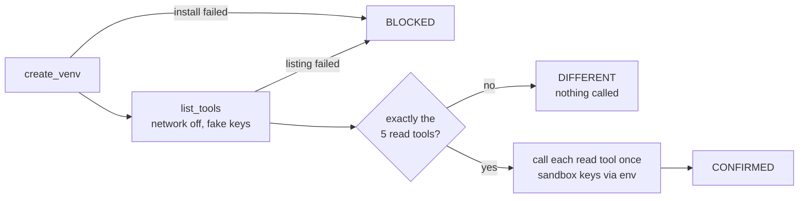

# C07 / D13: the Agent Toolkit is read-only

## 1. What this check proves

CounterSign's AI agent gets its PayPal tools from PayPal's Agent Toolkit. D13 builds the toolkit exactly as the agent will (version 1.11.0, LangChain adapter, our read-only configuration). It then proves that the toolkit hands over exactly five read tools, `list_disputes`, `get_dispute`, `get_shipment_tracking`, `get_order_details` and `list_transactions`, and nothing that can move money, such as `accept_dispute_claim`.

## 2. What you (the owner) will do

Nothing by hand. Run the command in section 6 after D1 is CONFIRMED. The check runs best after D2 and D8, because it reuses their order, capture and dispute IDs to call each read tool once. If they have not run, the tools that need those IDs are skipped and recorded as skipped, and the verdict is unaffected.

The install step needs internet access to PyPI (pip) and takes a minute or two.

## 3. What the script does, step by step

1. **create_venv.** The script makes a throwaway folder in your system temp directory (named `countersign-d13-...`, outside the repo) and creates a Python virtual environment in it. It installs `paypal-agent-toolkit==1.11.0` without its dependencies, then installs only what the LangChain adapter really imports: `langchain==0.3.23`, `requests` and `pydantic`. The toolkit's full dependency list includes CrewAI and OpenAI Agents packages that fail to build on Windows, and the LangChain adapter does not use them. The script records the installed versions. It saves the folder's name, so a resumed run reuses the same environment.
2. **list_tools.** The script writes a small helper program into that folder and runs it with the throwaway Python. The helper builds the toolkit with our configuration (`disputes: list, get`; `shipment: get`; `orders: get`; `transactions: list`; sandbox mode on) and prints the tool names. Networking is switched off inside the helper during this step, which proves that building the toolkit contacts nobody. No real credentials are given to it.
3. **assert_allowlist.** The script compares the names with the five-tool allowlist. If any tool is extra (for example `accept_dispute_claim`) or missing, it prints `D13 STOP` and no tool is ever called.
4. **call_tools** (only if the set is exact). The helper runs again, this time with the sandbox credentials passed in environment variables, never on the command line. It checks the tool set and the sandbox address a second time, and then calls each read tool once:
   - `list_disputes`: the first 10 disputes;
   - `get_dispute`: the dispute D8 opened;
   - `get_order_details`: an order from D2;
   - `get_shipment_tracking`: the $400 order's capture, which carries the tracking number;
   - `list_transactions`: the last 30 days.
5. **findings.** The script writes the verdict and deletes the throwaway folder.



## 4. What gets saved, and where

Everything goes under `recordings/sandbox/<date>/D13/`, redacted: credentials are replaced with `[REDACTED]`, emails with role aliases, and your home and temp paths with placeholders.

| File | Contents |
|---|---|
| `install_*.json` | the last lines of each venv and pip command, and its exit code |
| `list_tools.json` | the tool names, the tool class, whether the sandbox address was used, and the number of network attempts (expected: 0) |
| `call_tools.json`, `tool_<name>.json` | each read tool's answer, or its error type and HTTP status |
| `*_stderr.json` | the helper's warnings, if any |
| `findings.json` | the verdict, the versions, the allowlist comparison and a per-tool summary |
| `state.json` | progress, so a rerun resumes |

## 5. How the verdict is decided

- **CONFIRMED:** the toolkit exposes exactly the five read tools. A read tool that errors or is skipped is recorded but does not change this, because the question is which tools exist, not what they returned.
- **DIFFERENT:** any extra or missing tool, or the calling helper refused because the set or the sandbox address was wrong. Nothing is called. This is a stop-and-ask: the agent's startup check (C23) would refuse to start in the same situation.
- **BLOCKED:** the toolkit could not be installed or listed. That is missing evidence, not proof of a problem.

Facts from reading the 1.11.0 source that shaped the check:
- A tool switches on when any one of its configuration keys is true, and `disputes.create` switches on `accept_dispute_claim`. The check therefore checks both our configuration keys (list and get only) and the resulting tool names.
- If you leave out `Context(sandbox=True)`, the toolkit points at **live** PayPal. Leaving out the context altogether crashes it.
- Building the toolkit makes no network call. Each tool call fetches its own access token.
- In 1.11.0, `get_shipment_tracking` with only an order ID is broken (it calls a method that does not exist), so the check passes the capture ID instead.

## 6. How to run it

```
cd <repo root>
.venv/Scripts/python.exe -m scripts.sandbox_checks run D13
```

To rerun from scratch, add `--fresh`; to resume an earlier day's run, add `--date YYYY-MM-DD`. The unit test `tests/unit/test_toolkit_allowlist.py` covers the same allowlist on every test run. It checks the real toolkit only where `paypal-agent-toolkit` is installed, and otherwise skips that part with a reason.
