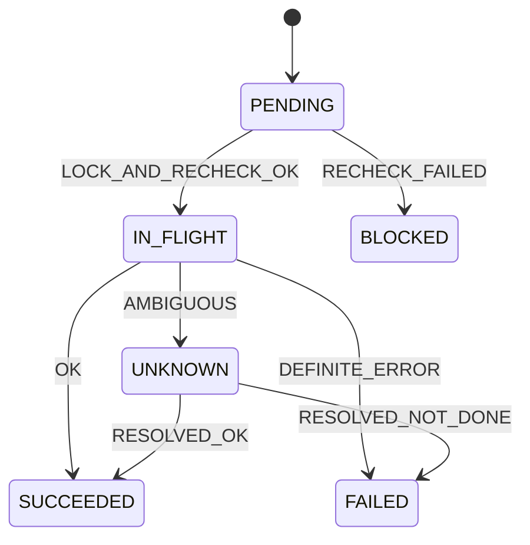
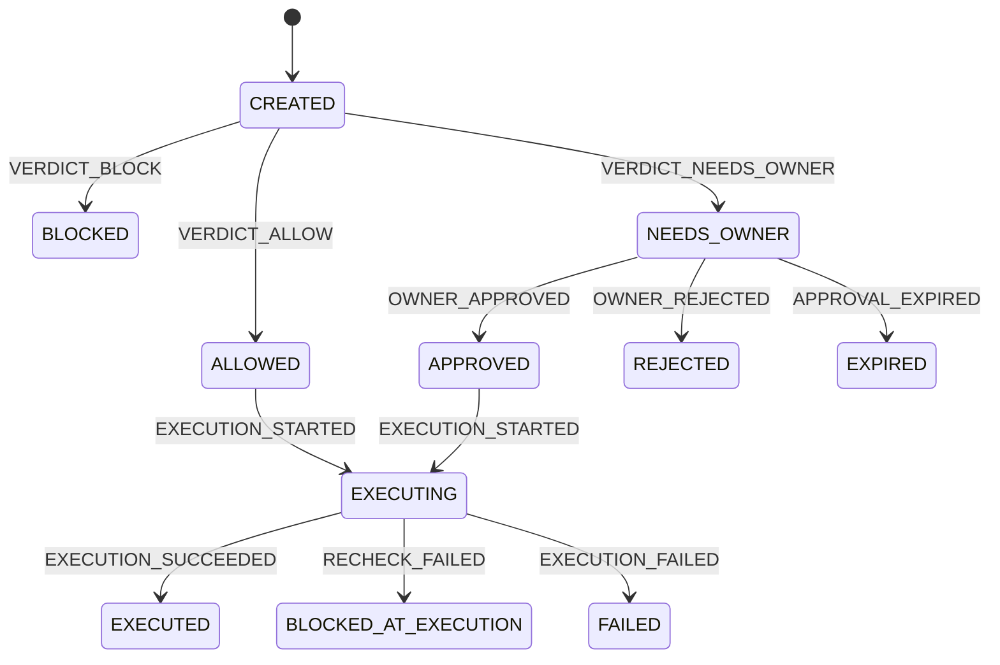
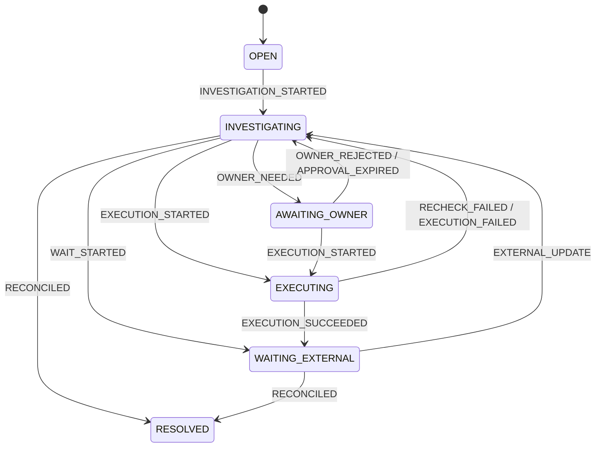
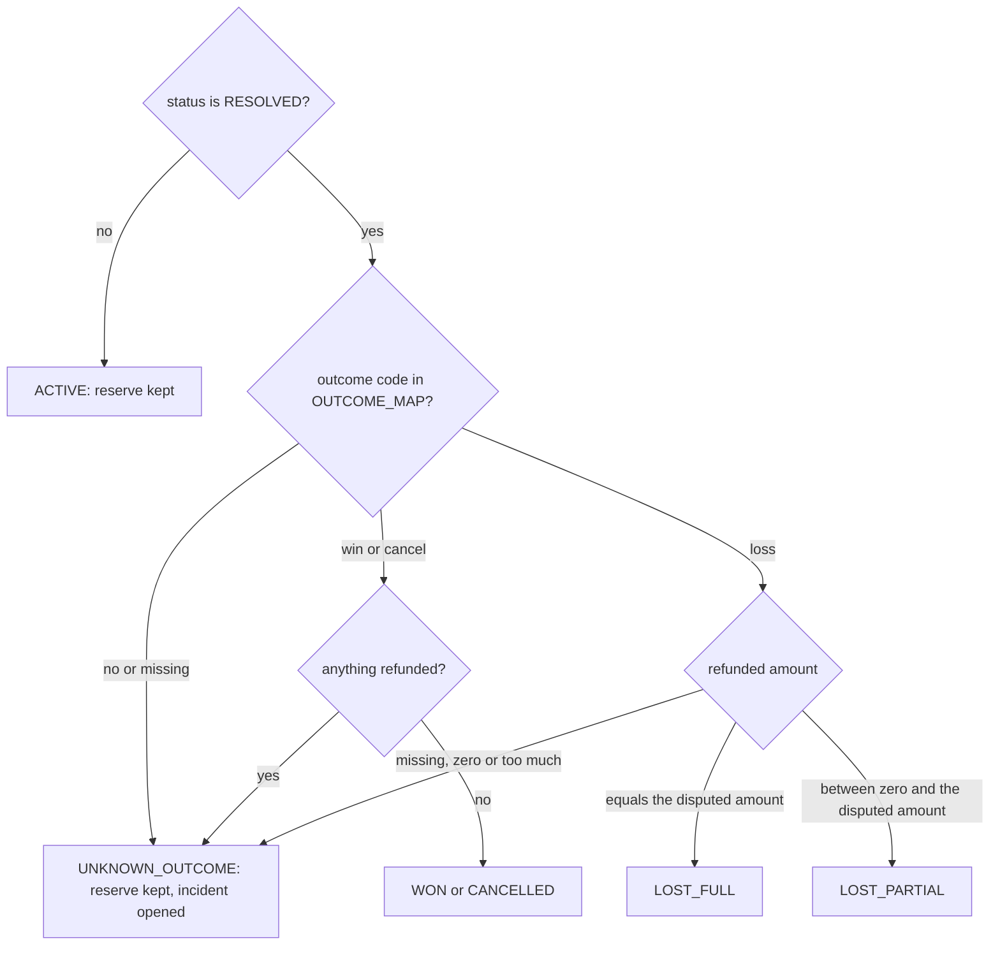

# C10: the control-side state machines

## 1. What this is

Four small rule books in `src/countersign/fsm/`. Each one lists the only moves a
record is allowed to make. They track the control side of CounterSign: what the AI
proposed, what the shield said, what was actually sent to PayPal, and when a problem
is really over.

| File | Record | One line |
| --- | --- | --- |
| `operation.py` | every PayPal write | written down *before* the call, so a lost reply is never forgotten |
| `proposal.py` | one AI suggestion | from the shield's verdict to "done" |
| `incident.py` | one money problem in the queue | closed only when the books and PayPal agree |
| `dispute.py` | a buyer dispute | PayPal's status is copied as-is; we work out a simple *phase* from it |

All of it is plain Python: no database, no network. The database layer (C12) asks
these tables before it changes any row, and refuses an illegal move.

## 2. Why it matters for safety

- **An operation in UNKNOWN can't be guessed out of.** If PayPal's reply is lost,
  the operation sits in UNKNOWN. Only the reconciler can move it on, after replaying
  the *identical* request: "it went through" (RESOLVED_OK) or "it didn't"
  (RESOLVED_NOT_DONE). A late reply is not enough.
- **No write without a second check.** An operation reaches IN_FLIGHT only after the
  rows are locked and every shield rule passes again (LOCK_AND_RECHECK_OK).
- **Only an ALLOWED or owner-APPROVED proposal can run.** A blocked, rejected or
  expired one can never start executing, and the shield can still stop it at the
  last moment (BLOCKED_AT_EXECUTION).
- **An incident is RESOLVED only when the reconciler says so.** The RECONCILED event
  means obligations, reserves and PayPal's own (GET-confirmed) states all match.
  Even a successful write goes to WAITING_EXTERNAL first, never straight to RESOLVED.
- **A dispute result we don't recognise keeps the money held.** If PayPal reports an
  outcome code we have not recorded yet, the phase is UNKNOWN_OUTCOME: the reserve for
  that dispute stays, and an incident opens for the owner.

## 3. The states

### Operation (PLAN 2.3, exactly)

### Proposal (PLAN 2.3; names match the dashboard contract)

While the PayPal write is UNKNOWN, the proposal simply stays EXECUTING.

### Incident

PLAN gives `OPEN -> INVESTIGATING -> AWAITING_OWNER | EXECUTING | WAITING_EXTERNAL -> ... -> RESOLVED`.
The "..." is filled with the smallest loop that works: anything that needs new thinking
goes back to INVESTIGATING.

RESOLVED can't be reached from OPEN (nobody has looked yet), from EXECUTING (a write
is still running) or from AWAITING_OWNER (the owner's decision is still open).

### Dispute phase (worked out, not moved)

PayPal decides how a dispute's status changes, and no document lists every move, so
there is no rule book of moves here. Each time we read the dispute from PayPal we
recompute its phase:

`OUTCOME_MAP` is **empty** today. PayPal's outcome codes will only be filled in from
the D10 sandbox recordings, so until then every resolved dispute comes out as
UNKNOWN_OUTCOME and the money stays held. Filling it after D10 is one line per code.

## 4. How it's tested

- **Every legal move** from PLAN is tried and must land on the right state.
- **Every other pairing** of state and event (the full grid) must be refused with
  `IllegalTransition`.
- The state names are read straight from `docs/PLAN.md` (the database CHECK lists)
  and `docs/CONTRACTS.md` (the lists the dashboard shows), so a rename on either side
  breaks the tests.
- The safety points above each have their own test: UNKNOWN leaves only through the
  reconciler, only ALLOWED or APPROVED proposals execute, RESOLVED needs RECONCILED,
  and every phase() branch, including each fail-closed case.

Run them:

~~~powershell
$env:PYTHONPATH = "src"
.venv\Scripts\python.exe -m pytest -q tests/unit/fsm/test_operation.py tests/unit/fsm/test_proposal.py tests/unit/fsm/test_incident.py tests/unit/fsm/test_dispute.py
~~~
