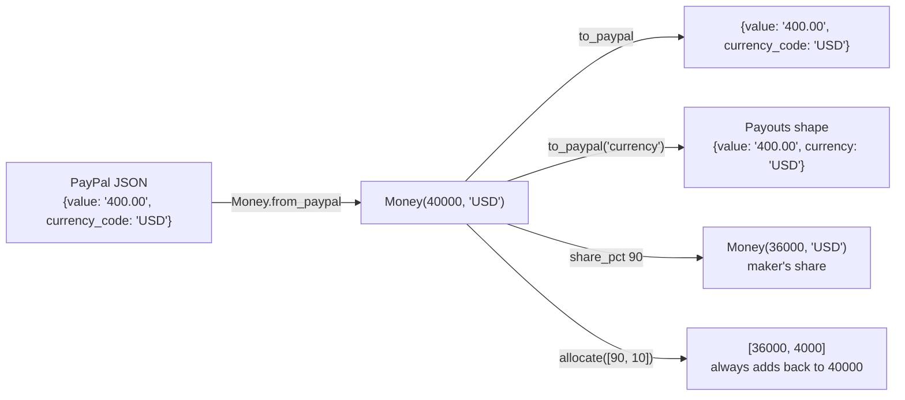

# C10: the Money type

## 1. What it is

`src/countersign/money.py` defines `Money`, the one way CounterSign holds an amount. It is two values:

- `minor`: a whole number of the smallest unit (cents for USD). $400.00 is `Money(40000, "USD")`.
- `currency`: a three-letter code. Only the currencies in a small table are allowed: USD, EUR and GBP (2 decimal places) and JPY (no decimal places). Anything else is refused.

A `Money` value can never be changed after it is made, so it is safe to pass around and to use as a dictionary key.

## 2. Why it matters for safety

Computers store decimals such as 0.1 inexactly. `0.1 + 0.2` is `0.30000000000000004` in Python. In a system that decides how much to pay people, a stray fraction of a cent can make a ledger fail to balance or a payout differ from what the owner approved. So the rule (PLAN section 2.1) is: **no floats anywhere**.

`Money` enforces that rule instead of trusting everyone to remember it:

| Mistake | What happens |
| --- | --- |
| `Money(400.0, "USD")` or `Money(True, "USD")` | Refused: the amount must be a whole number |
| `$100 + €100`, or comparing them | Refused with "Cannot mix USD and EUR" |
| `$100 * 0.9` | Refused: multiply only by whole numbers |
| `$100 / 3` | Refused: use `allocate` or `share_pct`, which never lose a cent |
| PayPal sends `"1.005"` for USD | Refused, not rounded: PayPal never sends that, so it means something is wrong |
| PayPal sends `"1e3"`, `" 1.00"`, `""` | Refused |

## 3. How amounts move in and out



- **Reading PayPal:** `Money.from_paypal(...)` accepts both shapes PayPal uses: `currency_code` (disputes, balances, orders, captures) and `currency` (Payouts). Negative values such as `"-300.00"` (from transaction search) are accepted. A value with fewer decimals, like `"400"`, is read exactly as $400.00.
- **Writing PayPal:** `to_paypal()` always writes exactly two decimals for USD (`"0.10"`, never `"0.1"`), and none for JPY.

## 4. The maker share and its rounding rule

Makers get a percentage of each order (90% in the demo). `share_pct(90)` or `share_bps(9000)` (basis points: 100 = 1%) takes only whole numbers.

When the share is not a whole number of cents, it is rounded **to the nearest cent, with an exact half rounded up** (away from zero for negative amounts). The rule is fixed in one named constant, `SHARE_ROUNDING`.

Why this rule: the demo week scenario (`eval/scenarios/demo_week.json`) has a $333.33 order for Maker C. 90% of that is 29,999.7 cents. The scenario and HANDOFF expect C to be paid **$300.00**, part of the $1,086 total. Rounding down (in the platform's favour) would give $299.99 and break the demo, so rounding to the nearest cent is what the data requires. No document says what to do on an exact half cent, so we chose "half up" and recorded it here.

## 5. Splitting without losing a cent

`allocate` divides an amount into parts that always add back to the exact total:

- `allocate(3)` splits evenly. $1.00 becomes 34, 33, 33 cents.
- `allocate([90, 10])` splits by weights. $333.33 becomes $300.00 and $33.33.

Each part first gets its share rounded down. The cents left over go one at a time to the parts that lost the most in rounding. On a tie, the earlier part wins. The same input always gives the same answer.

## 6. How it is tested

`tests/unit/test_money.py` has 295 tests (most are the same check over many inputs). They cover:

- construction: whole numbers only, three uppercase letters, unknown currency refused, cannot be changed;
- adding, subtracting, negating and comparing in one currency, and summing a list starting from `Money.zero("USD")`;
- every mixed-currency operation raising the mismatch error;
- floats and true/false refused for multiply, share and allocate; division always refused;
- the demo week shares ($360, $486, $54 and the $300 from $333.33) and the rounding of halves, including negatives;
- `allocate` summing exactly for many amounts and splits, positive and negative;
- PayPal strings: good ones parsed exactly, 22 malformed or over-precise ones refused, and a round trip (Money to PayPal and back) for every currency and both key names.

Run them from the worktree root:

```
PYTHONPATH=src .venv/Scripts/python.exe -m pytest -q tests/unit/test_money.py
```
