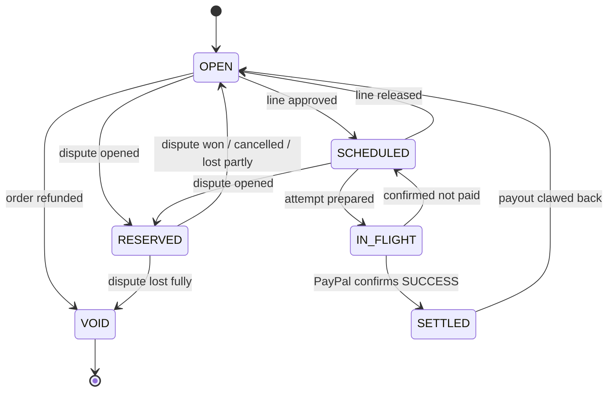
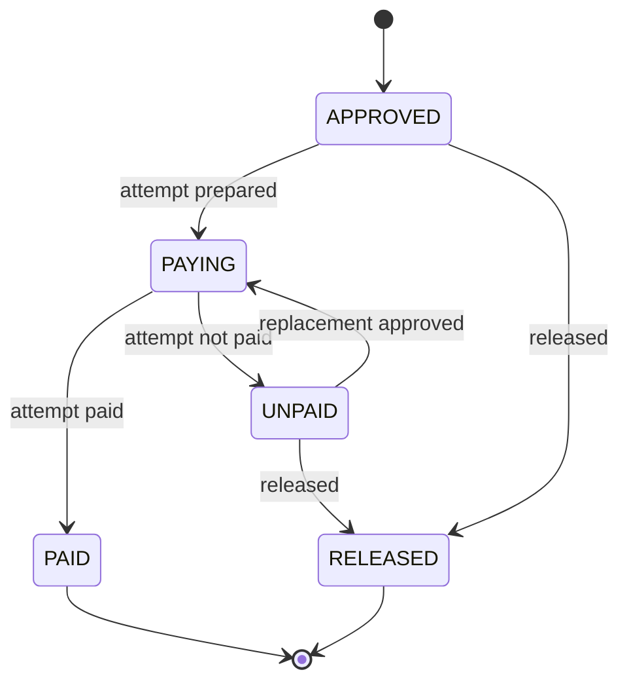
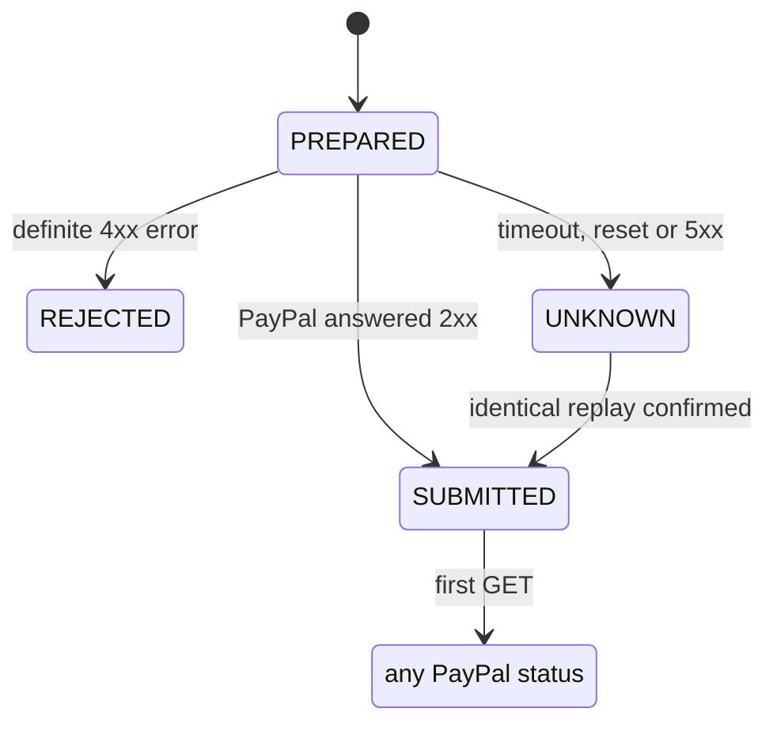
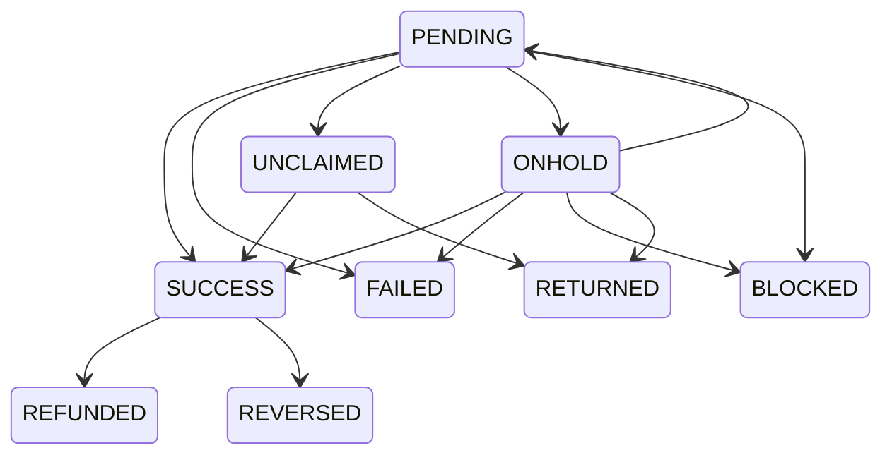

# C10: the payout state machines (obligation, line, attempt)

## 1. What this is

Three small rule books that say how money owed to a maker may move, step by step:

- an **obligation** is what the shop owes one maker for one order (or an adjustment);
- a **payout line** is one maker in one weekly run, grouping that maker's obligations;
- a **payout attempt** is one PayPal payout item sent for a line. A replacement is a new attempt on the same line.

Each rule book is a table of "from this state, on this event, go to that state". Anything
not in the table is refused with an `IllegalTransition` error before the database is touched.
The tables are copied from PLAN section 2.3. The code lives in `src/countersign/fsm/`
(`obligation.py`, `line.py`, `attempt.py`). It is pure Python: no database, no PayPal calls.

## 2. Why it matters for safety

- **No paying twice.** An obligation that is SETTLED cannot be scheduled again. A line that
  is PAYING cannot be released or replaced until PayPal's answer is confirmed.
- **A dispute on money already sent is not hidden.** If a buyer opens a dispute while the
  maker's payout is IN_FLIGHT, the obligation does not move. The code opens a
  PAID_BEFORE_DISPUTE incident for you instead.
- **"Settled" means PayPal said SUCCESS.** An UNCLAIMED payout keeps the obligation
  IN_FLIGHT. Only a confirmed SUCCESS settles it.
- **Webhooks never move money state.** A webhook only tells us to ask PayPal (a GET).
  The GET answer is what gets recorded. A forged or out-of-order webhook therefore cannot
  mark anything paid.
- **Surprises are kept, not dropped.** If PayPal reports a status jump we did not expect,
  we still record what PayPal says and open an incident.
- **At most one live attempt per line.** The `LIVE` list here is the same list the
  database uses for its unique index, and a test checks they match.

## 3. The states

### Obligation

When a dispute is lost partly, the same database transaction also adds an ADJUSTMENT
obligation for the refunded share.

### Payout line

### Payout attempt

Our own steps, before PayPal has the item:

From SUBMITTED onward the attempt copies PayPal's item status. These are the moves we
expect; any other move is still recorded, and opens an incident:

The first GET after SUBMITTED may show any PayPal status, and it is always recorded. It counts as expected unless it is RETURNED, REFUNDED or REVERSED: those need a history we never saw (a cancel, 30 days, a clawback), so they open an incident for a human to look at.
Seeing the same status again is not a move.

Other constants in `attempt.py`:

- `LIVE`: PREPARED, SUBMITTED, UNKNOWN, PENDING, UNCLAIMED, ONHOLD, BLOCKED (one per line).
- `WEBHOOK_TO_STATUS`: which item status each payout webhook hints at. CANCELED and DENIED
  map to "GET decides", because they are not item statuses.
- `UNKNOWN_REPLAY_WINDOW`: 25 days. An UNKNOWN attempt is only resolved by an identical
  replay inside PayPal's 30-day key window. After 25 days it goes to you.

## 4. Still waiting on sandbox checks

These parts follow PLAN's default for now and will be updated from the day one findings:

- the expected PayPal moves (`PAYPAL_EXPECTED`), pending D3 to D5;
- the webhook mapping (`WEBHOOK_TO_STATUS`), pending D5 and D7;
- which 4xx errors count as a definite rejection, and how an UNKNOWN replay is confirmed,
  pending D6 and D7.

## 5. How it is tested

`tests/unit/fsm/test_obligation.py`, `test_line.py` and `test_attempt.py`:

- every legal move in PLAN is tried, and must land on PLAN's target;
- every other (state, event) pair is tried, and must be refused;
- every PayPal-to-PayPal status move is tried through `mirror()`: the expected ones return
  "expected", the rest return "unexpected", and in both cases the new status is kept;
- the safety rules above each have their own test (dispute on IN_FLIGHT, only SUCCESS
  settles, a PAYING line cannot be released);
- the state names are read from the SQL in PLAN section 2.2 and must match exactly, and
  `LIVE` must match the `uq_one_live_attempt` index.

Run them with:

~~~powershell
$env:PYTHONPATH = "src"; .venv\Scripts\python.exe -m pytest -q tests/unit/fsm
~~~
