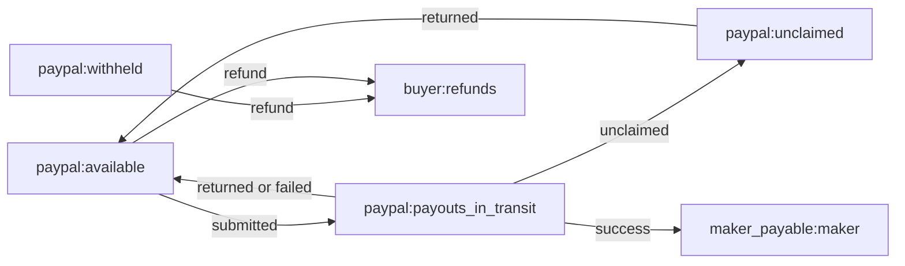

# C16: the ledger and the money we hold back

## 1. What this adds

Two small modules that keep CounterSign's own record of money:

- **Journals** (`src/countersign/ledger/journal.py`). Every time a payout or refund
  changes where money sits, CounterSign writes one journal: a set of lines (postings)
  that move an amount from one account to another. Each journal must add up to zero,
  so money can move but is never created or lost.
- **Reservations** (`src/countersign/ledger/reservations.py`). Money we deliberately
  hold back: a dispute earmark (a maker's share of a disputed order), cash for a
  pending proposal, or cash for an approved payout run.

The cash formula that turns these into "how much is really free" (`cash.py`) was
already done; this card feeds it real database rows.

## 2. Why it keeps money safe

- **Balanced or nothing.** A journal is checked for balance in Python before any SQL,
  and PostgreSQL checks it again when the transaction commits. A broken journal is
  refused twice.
- **Written once.** If the same event for the same operation is reported twice (a
  duplicate webhook, a retried worker), the second write returns the first journal
  instead of posting again. If the repeat carries a different amount, it is refused.
- **One earmark per disputed share.** A dispute can never hold the same maker's share
  twice, and an earmark can only point at an obligation on the disputed order.
- **No double spending of a hold.** A reservation moves from ACTIVE to RELEASED or
  CONSUMED once. A second release or consume fails loudly.
- **Fail closed.** Unknown accounts, zero or negative amounts, a missing link (a run
  reservation without its run), or writing outside a transaction all raise errors.

## 3. The accounts and the journals

Accounts come from PLAN 2.2. A positive line is a debit, a negative line a credit.

| Event | Debit (+) | Credit (-) |
| --- | --- | --- |
| Payout submitted | `paypal:payouts_in_transit` | `paypal:available` |
| Payout unclaimed | `paypal:unclaimed` | `paypal:payouts_in_transit` |
| Payout success | `maker_payable:<maker id>` | `paypal:payouts_in_transit` |
| Payout returned (cancelled or never claimed) | `paypal:available` | `paypal:unclaimed` or `paypal:payouts_in_transit` |
| Payout failed after submission | `paypal:available` | `paypal:payouts_in_transit` |
| Refund | `buyer:refunds` | `paypal:withheld` or `paypal:available` (caller must say which) |

Maker C's typo in the demo week walks submitted, unclaimed, returned: the three
journals net to zero, so the $300 is fully back in available.

## 4. How "written once" works

The journals table has no column for the event and no unique key. So the event name
starts the memo (`PAYOUT_SUBMITTED: payout submitted`), and before looking for an
existing journal the writer takes a PostgreSQL advisory lock on
`(operation id, event)` for the rest of the transaction. A second writer waits, then
sees the first one's journal. This only works at READ COMMITTED (the executor's level),
so other isolation levels are refused. Dispute earmarks use the same lock on
`(dispute id, obligation id)`, because the schema has no unique index for them either.

## 5. Demo numbers (HANDOFF section 10, Thursday)

| Item | Amount |
| --- | --- |
| PayPal available | $1,340 |
| Maker A earmark (90% of $400) | $360 (not subtracted from cash) |
| Maker B earmark (90% of $60) | $54 (not subtracted from cash) |
| Approved run: B $486 + C $300 + C $300 | $1,086 |
| **Unreserved** | **$254** |
| **Earmarked** | **$414** |

## 6. How it is tested

- `tests/unit/ledger/test_journal.py` (no database): every journal builder balances in
  USD and JPY at many sizes; each moves money between the right accounts; the
  submitted/unclaimed/returned path nets to zero; hand-made unbalanced, mixed-currency,
  zero-amount and unknown-account journals are refused; earmarks are $360 and $54.
- `tests/integration/ledger/test_ledger_db.py` (real PostgreSQL 16, skipped without
  `COUNTERSIGN_TEST_DATABASE_URL`): every builder's journal commits; a hand-made
  unbalanced journal is rejected by the database at commit; a repeat returns the same
  journal; a different repeat conflicts; two connections racing post once; writing
  outside a transaction or at REPEATABLE READ is refused; reservation moves are
  guarded; one active earmark per dispute and obligation; and the Thursday position
  above is rebuilt from database rows and gives exactly $254 unreserved and $414
  earmarked. Each test uses its own schema, dropped afterwards.

## 7. Still open

- Whether unclaimed payout money is excluded from PayPal's available balance is
  **[pending D4]**. The unclaimed journal assumes it is.
- Whether a refund on a held dispute comes from withheld or available money is
  **[pending D10]** (F17), which is why the refund journal makes the caller choose.
