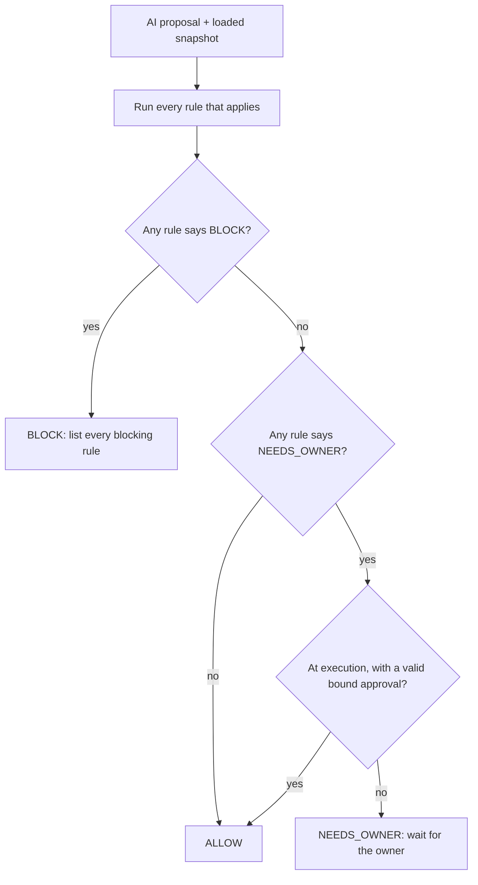

# C17: the safety shield

## 1. What this is

The shield is the code that "countersigns". The AI only ever writes a **proposal**: "pay
this week's run", "cancel this unclaimed payout", "accept this claim". Before anything
happens, the shield checks the proposal against ten fixed rules and gives one of three
answers:

- **ALLOW**: it may go ahead;
- **BLOCK**: it must not happen, and the answer names every rule that said no;
- **NEEDS_OWNER**: it waits for you to approve that exact proposal.

The shield is pure Python with no database, no network and no PayPal calls. Whoever asks
(the engine when the AI proposes, the executor just before it pays) first loads the records
into a **snapshot**: the obligations, payout lines and attempts, the maker and their email,
the dispute, the reservations, the cash position, the approval and the time. Given the same
proposal and the same snapshot, the shield always gives the same answer.

The code lives in `src/countersign/shield/`:

- `snapshot.py`: the proposal and snapshot record types;
- `engine.py`: the verdicts, `evaluate()` and how the answers combine;
- `rules/`: one file per rule.

## 2. Why it keeps money safe

The shield runs **twice**: once when the AI proposes, and again inside the executor's locked
database transaction, right before the PayPal call. Anything that changed in between, such as
a new dispute, a changed email or a used approval, is caught the second time.

| Rule | What it stops |
| --- | --- |
| SETTLEMENT | Paying an obligation that is already SETTLED, or one already in a live payout. This is the demo moment "a schema-valid proposal that would pay an already settled obligation is blocked". |
| PAYOUT_STATE_MACHINE | Any move the state machines do not allow, for example a new attempt while the previous one is PENDING, ONHOLD, BLOCKED or UNKNOWN, or cancelling an item that is not UNCLAIMED. |
| CANCEL_BEFORE_REPLACE | Resending a payout before PayPal's own GET shows the old item RETURNED (or FAILED, or our call was REJECTED). A webhook alone is never enough, and "CANCELED" is not an item status. |
| IDEMPOTENCY | Keys that are not `cs-<line id>-a<attempt number>`, or keys reused for a different payout. A payout lost in a network drop (UNKNOWN) is only ever replayed byte for byte, within 25 days; after that it goes to you. |
| WRITE_AHEAD | Calling PayPal without first saving a PENDING operation record with the same payload fingerprint (hash). |
| DISPUTE_RESERVE | Paying a maker's share of an order under dispute, and releasing that reserve before the dispute has ended. |
| FUNDING | Spending more than unreserved cash. The run's own reservation is counted once, not twice, and dispute earmarks never reduce cash (PayPal already holds that money). |
| PAYEE_INTEGRITY | Paying any email except the maker's owner-verified one. Any email or "refund_to"-style field inside a proposal is blocked, so "the owner said refund me to this account" goes nowhere. |
| UNKNOWN_SCOPED | Acting on anything whose state is unknown: an UNKNOWN payout or operation, a dispute with an unrecognised outcome, or a record that was not loaded. Unknowns elsewhere do not stop unrelated payouts. |
| APPROVAL_BINDING | Running an owner-level action without your approval, or with an approval that is used, expired, for different contents, or over records that have changed since you approved. |

Two more safety habits:

- **Fail closed.** If a rule crashes, the answer is BLOCK. A proposal naming an unknown action
  cannot even be built.
- **Every answer is shown.** The result lists every rule that ran, including the ones that
  passed, so the dashboard can show why something was allowed, not only why it was blocked.

## 3. How the answers combine

A rule that does not apply to an action (for example FUNDING on a cancel) is listed as "not
applicable" and does not appear among the rule results. WRITE_AHEAD only applies at execution,
because before that no operation record exists yet.

## 4. Worked example: the Friday run

The run pays Maker B $486 and resends Maker C's returned $300 to C's corrected,
owner-verified email.

- **When the AI proposes it:** nine rules pass, and APPROVAL_BINDING says NEEDS_OWNER, because
  a payout run is an owner-level action. The answer carries the record versions you are
  approving.
- **When you approve and the executor runs it:** all ten rules run. The operation record is
  PENDING with the same hash, your approval is unused, unexpired and over the same versions,
  so the answer is ALLOW.
- **If Maker B's obligation was settled in between:** SETTLEMENT and PAYOUT_STATE_MACHINE
  block it. APPROVAL_BINDING also blocks it, because the obligation's version moved on.

## 5. How it is tested

`tests/unit/shield/`:

- `test_shield_rules.py`: for each of the ten rules, at least one PASS case and one BLOCK case,
  plus NEEDS_OWNER where the rule has one (IDEMPOTENCY past 25 days, APPROVAL_BINDING before
  execution). It also covers the demo cases: the settled obligation, the buyer injection
  (`refund_to`), a changed payee email, and an UNKNOWN payout on another line that must not
  block this one.
- `test_shield_engine.py`:
  - every evaluated rule is returned, PASS included;
  - BLOCK beats NEEDS_OWNER and lists every failing rule;
  - NEEDS_OWNER becomes ALLOW only at execution with a bound approval;
  - a crashing rule blocks;
  - the rule, verdict, outcome and action names equal the lists in `docs/CONTRACTS.md`;
  - every shield file imports only `money`, `fsm`, `ledger.cash`, itself and a few standard
    modules, and opens no files.
- `shield_world.py`: the demo-week records the tests share.

Run them with:

~~~powershell
$env:PYTHONPATH = "src"; .venv\Scripts\python.exe -m pytest -q tests/unit/shield
~~~
