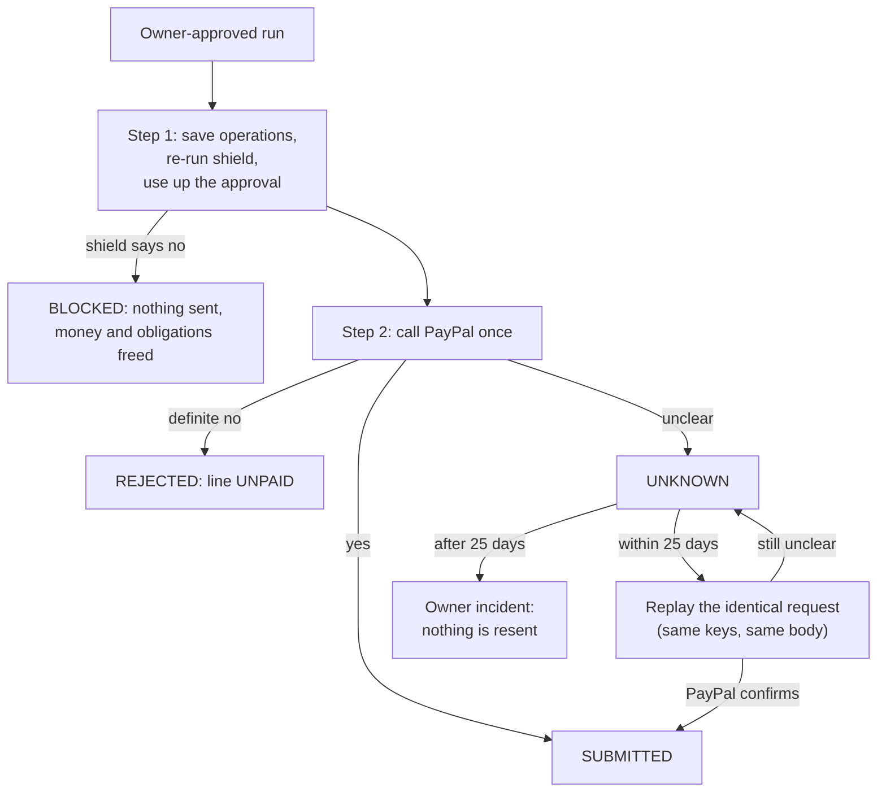

# C19: the executor, the only code that sends money

## What it is

Everything before this card decides *whether* a payout may happen: the AI proposes, the shield checks its rules, the owner approves. The executor is the one place that actually asks PayPal to send money. No other code is allowed to use PayPal's write adapter; an automatic import check fails the build if anything else tries.

## The three steps

1. **Save first (one locked transaction).** For each maker in the approved run, the executor writes down exactly what it is about to send (an "operation"). It runs every shield rule again, now with the owner's approval attached, and checks that the saved rows add up to exactly the payload the owner approved. Then it marks the approval as used, so it can never be used again, and creates each payout attempt as PREPARED.
2. **Call PayPal**, once per maker, outside the database transaction. It never retries automatically.
3. **Record the answer (one transaction per maker).**
   - PayPal said yes: the attempt becomes SUBMITTED and the books record the money as "in transit".
   - PayPal said a definite no (for example, not enough funds): the attempt is REJECTED and the maker's line becomes UNPAID, ready for an owner-approved replacement.
   - Anything unclear (timeout, dropped connection, server error): the attempt becomes **UNKNOWN**. It is never treated as "failed", because PayPal may have paid.

## Why it keeps money safe

- **A payment is never sent twice.** A payout UNKNOWN may replay the *identical* request with the same keys inside the replay window. D6 showed that PayPal answers even an exact duplicate with 400, so the executor follows the original batch link and checks its keys, payee and amount. A replay's 4xx never proves the first payment failed.
- **Old unknowns go to a person.** PayPal remembers request keys for about 30 days. After 25 days a replay could create a second payment, so the executor opens an owner incident and sends nothing.
- **A crash mid-send is safe.** If the program dies after calling PayPal but before writing down the answer, the payout sits IN_FLIGHT. After 10 minutes a sweep marks it UNKNOWN, and the identical replay finds out what happened.
- **Approvals are single use and exact.** If anything the owner saw changes after approving (a maker's details, an amount), or the 30 minutes run out, the shield blocks at execution. Nothing is sent, and the run's money and obligations are freed.
- **Two executors at once still pay once.** The second finds the run already taken and does nothing.

## How it's tested

Tests run against a real PostgreSQL database and in-process PayPal responses. A counter on the connection proves exactly how many requests went out. No sandbox credentials or real PayPal calls are used.

| Test | Proves |
| --- | --- |
| Approved run | Each maker paid once; approval used; run DONE; books written once |
| Lost response | The dropped answer becomes UNKNOWN; the replay confirms it; PayPal still has exactly one payment per maker |
| Two executors at once | One attempt per line, one payment per maker |
| Stale or expired approval | Blocked; zero requests sent; obligations back to OPEN |
| Definite rejection | Line UNPAID, obligations wait for a replacement, no money booked |
| Crash before the call | Stale IN_FLIGHT becomes UNKNOWN, then a replay; still one payment each |
| UNKNOWN after 26 days | One owner incident; zero requests sent |
| New actions | Cancel, evidence and accept-claim use committed operations, fresh shield checks and one POST |
| Refund source unset | One audit reason; proposal and unused approval remain unchanged until configuration is available |

## Cancel, evidence and accepting a claim

Cancellation sends no body. Even when its POST says RETURNED, the attempt remains unchanged until an item GET confirms RETURNED with the same identity, payee, keys and amount. The existing reconciliation code then returns the line to UNPAID and its obligations to SCHEDULED, and journals the return once. ITEM_ALREADY_CANCELLED also leads to a GET.

Evidence comes from the order's stored carrier and tracking number. The dispute must currently be WAITING_FOR_SELLER_RESPONSE and offer a provide_evidence link; its lifecycle stage does not decide eligibility. Multipart with an input JSON part is the default. PAYPAL_EVIDENCE_FORMAT can select json once D10 establishes the format.

Accepting a claim always needs the owner and sends a fixed trusted note with accept_claim_type REFUND. PAYPAL_ACCEPT_CLAIM_FORMAT defaults to json and can select multipart. Before Transaction A, the executor checks PAYPAL_REFUND_SOURCE. Until Claude sets paypal:available or paypal:withheld from D10's balance observations, acceptance is deferred with one REFUND_SOURCE_UNCONFIGURED audit. It changes neither the proposal nor the approval. The same approved proposal can run after configuration, subject to the usual expiry and fresh checks. The source is frozen in the operation's write-ahead response metadata so recovery cannot debit another account after a configuration change.

Evidence and acceptance POSTs are never replayed automatically. After a lost answer or a crash, the executor GETs the dispute. Matching evidence, a changed status or removal of the evidence link can confirm submission. Acceptance requires a RESOLVED dispute showing the exact approved refunded amount; an unfamiliar outcome code is not guessed. If the GET cannot decide, the operation stays UNKNOWN and one AWAITING_OWNER incident asks a person to investigate.

The stored request includes its internal target, PayPal target, stable request ID, exact body and format. Dispute requests also bind the prior status and action links; acceptance binds the refund amount. The owner's SHA-256 hash covers the canonical JSON envelope containing action, params and this request. Execution rebuilds it from locked records and checks the saved request and approval before consuming permission or sending HTTP. Model-supplied notes, tracking and bodies are never forwarded.

## The D6 duplicate link

PayPal's real duplicate response places the original batch in details[].link, even when top-level links is empty. Its host is api.sandbox.paypal.com, while our configured origin is api-m.sandbox.paypal.com. The adapter reads both link locations, permits that one HTTPS alias with no port or port 443, keeps only a valid batch path, and sends the GET to the configured origin. Queries, other hosts and non-batch paths are refused. A linked batch with different keys, payee or amount stays UNKNOWN.
