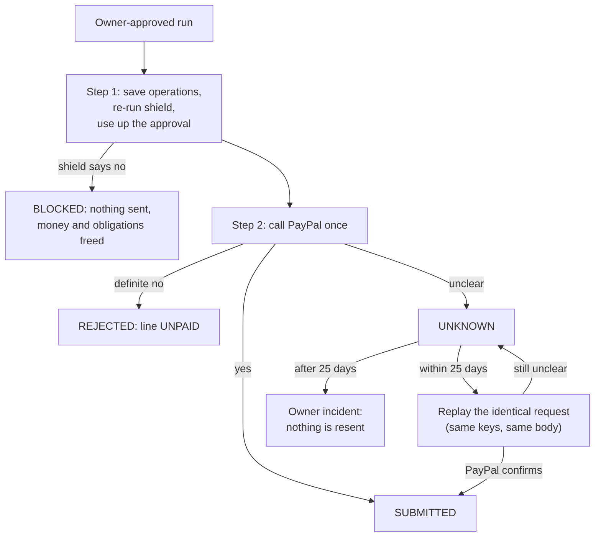

# C19: the executor, the only code that sends money

## What it is

Everything before this card decides *whether* a payout may happen: the AI proposes, the shield checks 10 rules, the owner approves. The executor is the one place that actually asks PayPal to send money. No other code is allowed to use PayPal's write adapter; an automatic import check fails the build if anything else tries.

## The three steps

1. **Save first (one locked transaction).** For each maker in the approved run, the executor writes down exactly what it is about to send (an "operation"). It runs all 10 shield rules again, now with the owner's approval attached, and checks that the saved rows add up to exactly the payload the owner approved. Then it marks the approval as used, so it can never be used again, and creates each payout attempt as PREPARED.
2. **Call PayPal**, once per maker, outside the database transaction. It never retries automatically.
3. **Record the answer (one transaction per maker).**
   - PayPal said yes: the attempt becomes SUBMITTED and the books record the money as "in transit".
   - PayPal said a definite no (for example, not enough funds): the attempt is REJECTED and the maker's line becomes UNPAID, ready for an owner-approved replacement.
   - Anything unclear (timeout, dropped connection, server error): the attempt becomes **UNKNOWN**. It is never treated as "failed", because PayPal may have paid.

## Why it keeps money safe

- **A payment is never sent twice.** UNKNOWN is resolved only by repeating the *identical* request with the same keys. PayPal treats that as the same payment and tells us what happened. A new request is never made.
- **Old unknowns go to a person.** PayPal remembers request keys for about 30 days. After 25 days a replay could create a second payment, so the executor opens an owner incident and sends nothing.
- **A crash mid-send is safe.** If the program dies after calling PayPal but before writing down the answer, the payout sits IN_FLIGHT. After 10 minutes a sweep marks it UNKNOWN, and the identical replay finds out what happened.
- **Approvals are single use and exact.** If anything the owner saw changes after approving (a maker's details, an amount), or the 30 minutes run out, the shield blocks at execution. Nothing is sent, and the run's money and obligations are freed.
- **Two executors at once still pay once.** The second finds the run already taken and does nothing.

## How it's tested

Nine tests run against a real PostgreSQL database and the PayPal mock. A counter on the connection proves exactly how many payout requests went out.

| Test | Proves |
| --- | --- |
| Approved run | Each maker paid once; approval used; run DONE; books written once |
| Lost response | The dropped answer becomes UNKNOWN; the replay confirms it; PayPal still has exactly one payment per maker |
| Two executors at once | One attempt per line, one payment per maker |
| Stale or expired approval | Blocked; zero requests sent; obligations back to OPEN |
| Definite rejection | Line UNPAID, obligations wait for a replacement, no money booked |
| Crash before the call | Stale IN_FLIGHT becomes UNKNOWN, then a replay; still one payment each |
| UNKNOWN after 26 days | One owner incident; zero requests sent |
| Non-paying action | Refused before anything changes (cancel, evidence and accept-claim come in a follow-up card) |
