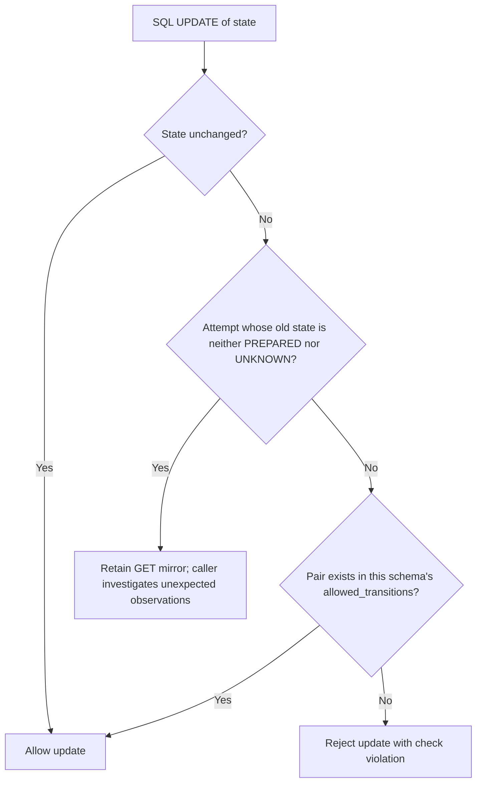

# C22: database transition guards and generated safety tests

CounterSign already checks state changes in Python. C22 adds a second check in PostgreSQL so a direct SQL update cannot skip the same rules. It also generates event histories to test settlement, one-live-attempt and cash-reservation invariants.

## What the migration adds

Migration `0004_allowed_transitions.py` creates `allowed_transitions(entity, from_state, to_state)`. Its primary key covers all three columns. The 50 distinct pairs come from the actual obligation, line, attempt, operation, proposal and incident state machines. Different events reaching the same pair share one database row.

`migrations/generate_transitions.py` reads those machines and writes `migrations/sql/0004_allowed_transitions.json`. The revision inserts that checked-in output instead of importing changing application code when somebody applies an old migration. A unit test derives the expected rows independently from the Python tables and compares them with the frozen output. Database tests compare the installed rows too. A changed or missing transition is visible as drift.

Run `PYTHONPATH=src python migrations/generate_transitions.py --check` to check the snapshot. Before 0004 is published, the generator can regenerate it. Later state-machine changes need a new migration and corresponding drift-test updates; do not silently rewrite migration history.

One `BEFORE UPDATE OF state` trigger function serves six tables: `obligations`, `payout_lines`, `payout_attempts`, `operations`, `proposals` and `incidents`. A change absent from the table raises PostgreSQL check violation `23514`, naming `allowed_transitions`. The transaction retains its previous row. A same-state update passes. Inserts remain available for confirmed historical bootstrap records; this is an update guard, and the existing state-enum checks still apply. There is no payout-run FSM in C10, so payout_runs is outside this migration.

The trigger reads the transition table in the updated row's schema using `TG_TABLE_SCHEMA`. A different caller search path, including a shadowing temporary table, cannot select a more permissive allowlist. Downgrade removes all six triggers, the function and the table. A round-trip test verifies that upgrade restores enforcement.

## Why payout attempts are different

PREPARED and UNKNOWN are CounterSign-owned attempt states. Their legal moves come from `attempt.OURS`. Once an attempt is SUBMITTED, its state mirrors a PayPal item GET. PayPal can report a surprising status, and PLAN says to retain it and open an incident. The transition trigger therefore checks only moves whose **old** attempt state is PREPARED or UNKNOWN. It does not turn the expected-mirror map into an external-state allowlist.

The one-live-attempt index remains separate and unchanged. It still prevents two live attempts for a line. If a surprising historical observation conflicts with that index, the existing reconciler preserves it in the raw resource mirror and opens an incident. C22 does not weaken that protection or invent new FSM transitions.

## What the generated tests exercise

The Hypothesis dependency is added only to the dev extras. Example counts are bounded. Database histories use rollback isolation, while executor races use a fresh migrated schema for each example through the existing schema fixture.

- **Settlement:** up to 200 random event sequences call the real obligation machine. Illegal events are rejected. Each interval between successful `PAYOUT_CLAWED_BACK` events contains at most one entry into SETTLED. An explicit sequence covers settlement, clawback and another settlement. The pure FSM receives the clawback event; existing application integration tests remain responsible for requiring GET confirmation before emitting it.
- **One live attempt:** up to 60 random prepare, submit, ambiguous, replay and GET-observation histories run through the actual attempt functions and PostgreSQL index. Repeated prepare attempts must raise the named unique violation while another attempt is live.
- **External mirrors:** up to 100 source/status combinations call the real `mirror` function and persist the result. Explicit surprising cases include SUCCESS to PENDING and a first SUBMITTED to REFUNDED observation.
- **Executor races:** eight bounded generated cases race two separate executor objects on the same approved line through the real mock transport. They check one attempt, one actual payout POST and one settled obligation, including repeated execute calls. Each example gets its own migrated `cs_test_<uuid>` schema and database pool, which closes before fixture cleanup drops the schema. It never calls `Engine.reset()`, so the test also works when the database is named `countersign`. Each example resets the mock and uses a fresh HTTP client because resetting the mock invalidates OAuth tokens. After advancing mock time, it waits up to 60 seconds for observed settlement through repeated ticks: the database-wide reconciliation lock can make a tick skip polling with zero errors while another schema is active. Unexpected obligation states and tick errors still fail immediately.
- **Cash:** up to 200 random integer-money cases vary currencies, outflows, refresh boundaries and reservation lists. Earmarks change only the displayed earmarked total. RUN_CASH and PROPOSAL_CASH reduce free cash by exactly their sum. No inflow is invented and no hold is subtracted twice.
- **SQL bypass:** up to 120 illegal state pairs must fail at the database boundary without changing the row. All 50 generated legal pairs and same-state updates are tested separately. A temporary shadow allowlist cannot bypass the guard.

No real PayPal or model call is made. Hypothesis examples are not separate pytest test counts; the final report gives pytest counts and suite wall time separately.

## Files and running the checks

| Files | Purpose |
| --- | --- |
| `migrations/generate_transitions.py` | Generate or check the frozen state pairs |
| `migrations/sql/0004_allowed_transitions.json` | The reproducible revision input |
| `migrations/versions/0004_allowed_transitions.py` | Transition table, shared function, six triggers and downgrade |
| `tests/unit/fsm/test_transition_snapshot.py` | Frozen-row drift and mutation checks |
| `tests/property/conftest.py`, `hardening_world.py` | Reuse schema/harness fixtures and create constraint-valid test records |
| `tests/property/test_attempt_invariants.py` | Random histories, unique index and external mirrors |
| `tests/property/test_concurrent_executors.py` | Two real executors racing against the mock |
| `tests/property/test_money_and_settlement.py` | Settlement and integer-cash properties |
| `tests/property/test_transition_guards.py` | Direct SQL, schema isolation and downgrade/upgrade checks |
| `pyproject.toml` | Hypothesis in dev extras only |
| `tests/integration/test_harness.py` | Expect revision 0004 after reset |
| `tests/integration/executor/test_actions.py`, `tests/integration/test_c24.py` | Constraint-valid fixture setup and reconciliation mismatch injection |
| `docs/DECISIONS.md`, walkthrough index and this page | Design reasons and verification handoff |

Use the existing CounterSign-db `.venv`, set `PYTHONPATH=src` and point `COUNTERSIGN_TEST_DATABASE_URL` at the standard local PostgreSQL 16 database (`127.0.0.1:55432/countersign`). The existing fixtures create `cs_test_<uuid>` schemas; the race test does not require a database name ending in `_test`. The harness reset tests separately create randomly named disposable `_test` databases to exercise the unchanged reset guard. Run `python -m pytest -q --tb=short -rs`, `ruff check .`, `lint-imports`, and the generator's `--check` command.

## Fixture repairs exposed by the guard

The first full run found three test-only shortcuts:

- The cancellation setup changed an obligation directly from OPEN to IN_FLIGHT. It now follows OPEN to SCHEDULED to IN_FLIGHT.
- The unapproved-claim test rewrote NEEDS_OWNER to ALLOWED. It now constructs the deliberately unapproved proposal using the legal CREATED to ALLOWED verdict path, and still verifies that execution is refused without owner approval.
- The C24 reconciliation test changed a SETTLED obligation back to IN_FLIGHT to inject a mismatch. It now injects and repairs a one-minor-unit amount mismatch, preserving the test's requirement that an unreconciled obligation prevents closure without manufacturing an illegal state or a fictional clawback.

The harness reset test also expects migration revision 0004. The guard and generated pairs were not changed to accommodate these fixtures.

Review then caught an isolation error in the race property: it called `Engine.reset()` on the shared world fixture. The initial run used a database ending in `_test`, which hid the failure on the standard database named `countersign`. Each generated race now creates a fresh migrated schema instead of resetting the shared database. The production reset guard is unchanged.

Validation on the shared server also exposed the race test's one-tick assumption. A busy reconciliation cycle is legitimate, so the test now waits for actual settlement within a timeout rather than treating zero errors as proof that a GET happened. It retains the one-attempt, one-POST and final-settlement assertions.

C21's worktree and owned slice files are untouched. No application state machine has been edited. The full suite exposed no illegal application transition; the three shortcuts above were confined to tests.

## Standard-environment review and rebase (October 25, 2026)

The review correction uses the standard PostgreSQL connection at `127.0.0.1:55432/countersign`, without renaming the database or weakening `Engine.reset()`. The original temporary-database result did not expose the reset-name dependency and is superseded by this validation.

The branch was first rebased onto `eee26ab` (PRs #4 and #5 and contract 1.0.3). Main then advanced during verification, so it was rebased again onto **`36b8dbe3ea6e70f351a944a6575f79a2031027ac`**, including PR #6 and the updated duplicate-link contract test. **DECISIONS.md was the only conflict in each rebase. Both sides' rows were retained**, including the contract 1.0.3 and M09a decisions. Application code, the reset guard, contract text and mate-owned files have no C22 edits relative to that main base.

Observed review runs before the final rebase:

- The first full standard-URL run reported **2 failed, 2,215 passed, 6 skipped, 1 warning** in **2,345.88 seconds (39 minutes 5 seconds)**. The race property asserted settlement after a busy tick; C24's existing `add_dispute` helper indexed an empty list after its polling helper returned. The C24 test passed an isolated standard-URL rerun in **7.24 seconds**. No illegal application transition was reported.
- After adding the bounded settlement wait, the race property passed on the standard URL in **65.28 seconds**. Its one-attempt, one-POST and final-settlement assertions remain intact.
- The next run used fail-fast and stopped at Aman's `tests/mock_paypal/test_fault_transport.py::test_after_commit_connection_loss_over_tcp`: the local server readiness GET raised `httpx.ReadTimeout`. It reported **1 failed, 428 passed, 1 skipped, 1 warning** in **1,659.52 seconds (27 minutes 39 seconds)**. C24 passed in that run. The mate-owned transport test was not edited.

Concurrent test sessions and PostgreSQL checkpoint/disk-sync waits were observed during these runs. The standard database settings were not changed.

The latest-base run also encountered severe host file-read delays. A 30-second process-local watchdog captured `importlib.get_data` reading AnyIO package files while importing FastAPI, before the diagnostic test body began. A separate invocation of the first contract test passed once imports finished. PostgreSQL later showed one active writer spending more than 85 seconds in `DataFileImmediateSync`, with no lock blockers. These observations explain why verification remains slow; they are not a passing full-suite result.

The earlier `36b8dbe` attempt ended without a final result, and the standard PostgreSQL container was subsequently found stopped. The existing `countersign-db-postgres-1` container was started again; its image, port, database name and durability settings were not changed. A fresh full run used the exact standard URL, with a detached runner saving its exit status, log and JUnit report.

Final verification on `36b8dbe`:

- `pytest -q --tb=short -rs --junitxml=...`: **2,235 passed, 6 skipped, 0 failed**, with one existing Starlette/httpx deprecation warning, in **1,508.91 seconds (25 minutes 8 seconds)**. The runner exited with status **0**. This is the full run, including the corrected executor-race property and the previously flaky C24 and mock TCP tests.
- `ruff check .`: **0 issues**.
- `lint-imports`: **3 contracts kept, 0 broken**, analyzing 86 files and 284 dependencies.
- Generator `--check`: passed for **50 distinct pairs**.
- `git diff --check`: passed.

The six skips are one unpublished C09 sandbox-recording check and five optional PayPal Agent Toolkit/LangChain checks. No database integration test was skipped because of the standard database name. The standard-server suite exceeded the original approximate 15-minute target; the measured runtime above includes its database and host I/O delays.

The final log, JUnit XML and runner status are saved under the system temporary directory with the stem `countersign-c22-standard-36b8dbe-resumed`. No illegal application transition was found. There are no open implementation questions for this correction; the earlier concurrent-run fixture failures remain recorded above rather than being hidden by changing production guards.

No real PayPal or model call was made. The branch has not been pushed or merged into main.
