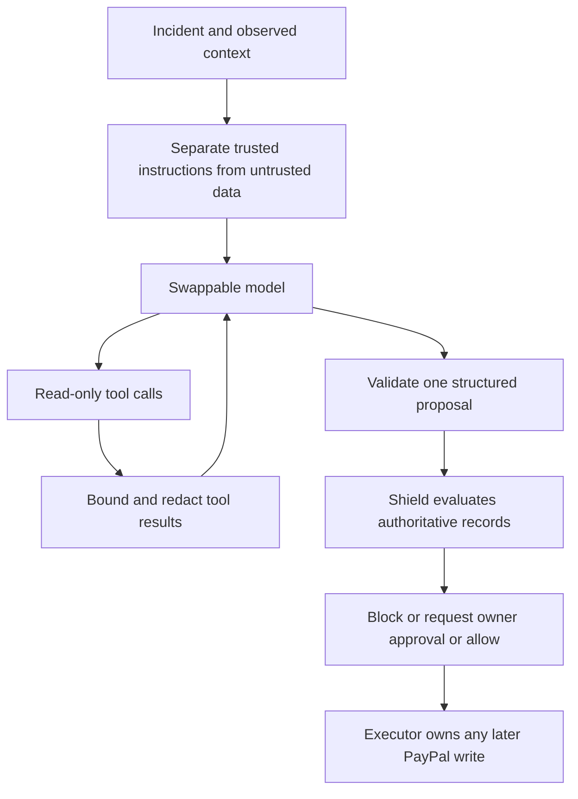

# C23: the Incident Commander

## 1. What this adds

The commander investigates an incident and proposes one next action. A proposal
contains the incident ID, action, parameters, evidence references, a reason and an
expected cash effect. Money uses integer minor units and a currency code.

The model can read through eight named tools. It cannot call the executor, import
the database layer or use the PayPal write adapter. The deterministic shield judges
its proposal before execution. The model has no authority to change a maker's payee.

## 2. How one step works



The scripted model makes this flow testable without a network or an API key.
Selecting a real model requires explicit configuration; missing configuration
raises an error rather than returning a simulated recommendation.

`Engine.tick()` processes the inbox, reconciles, investigates one eligible
incident, then routes ready proposals to the executor and runs its recovery
sweep. Background worker intervals are unchanged. With `llm=None`, the commander
stage is absent. The tick's existing `proposals` count still means proposals
routed successfully to the executor; stored drafts and blocked proposals appear
in the snapshot rather than increasing that count.

The worker filters execution with the same `shield.snapshot.PAYING` set the
current executor checks. Unsupported proposals retain their `ALLOWED` or
`APPROVED` state and their approvals. Each receives one `EXECUTION_DEFERRED`
audit reason, including when workers overlap. Deferred items do not take queue
slots from supported payouts. Once that shared capability set changes, the
unchanged proposals become eligible for execution.

## 3. The eight tools

The five toolkit tools are `list_disputes`, `get_dispute`,
`get_shipment_tracking`, `get_order_details` and `list_transactions`. They come
from the pinned PayPal Agent Toolkit LangChain adapter. Startup checks the exact
set, including duplicates. It refuses additional tools and missing tools.

CounterSign adds three tools:

- `get_payout_item`: a GET through the existing PayPal reader.
- `query_money_graph`: named parameterized queries over masked dashboard views,
  in a read-only PostgreSQL transaction as `countersign_agent_ro`.
- `simulate`: an injected read-only simulator. Until C24 supplies a simulator,
  the default explicitly reports `SIMULATOR_UNAVAILABLE`.

The toolkit runs in a child process with a restricted environment. PayPal,
LangChain and LangSmith environment variables do not pass into it. Credentials
are passed explicitly through its private input channel; tracing is disabled.
The configuration enables only the five read tools. It never enables
`disputes.create`, which would grant `accept_dispute_claim`.

On Windows, subprocess pipes use background threads so the toolkit can share
psycopg's SelectorEventLoop. A timeout or cancellation kills and reaps the child;
the closed gateway cannot consume a stale response or silently replay a call.

## 4. Untrusted text and public records

Buyer notes, dispute messages and tool results are data. They are never inserted
as system instructions. Suspicious destination changes and instructions produce
flags such as `PROMPT_INJECTION` and `PAYEE_CHANGE_REQUEST`. Pattern detection is
an investigative hint, not a claim to detect every possible injection.

The fixed tool capabilities, strict proposal validation and deterministic shield
provide the execution boundary. Tool responses, model input and stored proposal
text are bounded and redacted. Errors contain fixed descriptions, never private
transport errors, database URLs or keys.

The pure `INJECTION_GUARD` rule blocks flagged financial proposals. The original
`PAYEE_INTEGRITY` rule independently blocks payees supplied in proposal params.
The injected refund test records both checks. Flags are loaded again from the
stored proposal before execution, so approving or retrying cannot erase them.
The rule is part of contract 1.0.2; `PROMPT_INJECTION` remains a flag type.

Investigation happens outside database transactions. Saving a proposal takes the
existing financial lock, checks the incident version and loads authoritative
records for the shield. Concurrent commanders cannot commit two proposals for
the same incident version. An unchanged handled incident does not consume another
model step. Evidence references supplied by the model remain claims, not proof.
Rejected or expired agent decisions resume investigation on the next tick,
including owner decisions made through the HTTP API.

## 5. Switching on a real model

The owner must provide:

- A LangChain provider ID and its exact model ID. The model must support tool calls.
- That provider's API key, supplied through runtime configuration.
- A provider integration version compatible with the toolkit's LangChain adapter.

Install `paypal-agent-toolkit==1.11.0` with `--no-deps`, then the D13 adapter set
(`langchain==0.3.23`, `requests>=2.31.0`, `pydantic>=2.10`) and the chosen compatible
provider package. These optional dependencies are not added to `pyproject.toml`.
The configured PayPal endpoint must be reachable from the child process: a running
local mock HTTP service or the sandbox, using the existing explicit PayPal settings.
The database login must be able to assume `countersign_agent_ro`.

The facade re-exports `ChatModelConfig`, so eval callers still import only
`countersign.harness`. For an already configured engine settings object:

```python
from dataclasses import replace
from countersign.harness import ChatModelConfig

configured = replace(existing_settings, llm=ChatModelConfig(
    provider=provider_id, model=model_id, api_key=model_api_key,
))
```

Those values come from the owner's runtime configuration. Keys never belong in
chat or Git. Startup checks provider dependencies locally without a model call;
missing packages report `MODEL_DEPENDENCIES_REQUIRED`.

`ChatModelConfig` is the model configuration entry point. `ScriptedModel` is for
deterministic offline tests. Real model configuration does not silently fall back
to the scripted model. No real PayPal or LLM request is needed by the C23 tests.

## 6. Scope and remaining work

C23 supplies investigation, read tools, one proposal per step and the connection
to the shield. Claude's C19b supplies execution of cancel, evidence and claim
actions. C24 supplies the full simulator and remaining incident lifecycle rules.
The HTTP dashboard remains on fixtures until M15.

Waiting records `WAITING_EXTERNAL`; requesting help records `AWAITING_OWNER`;
drafting only stores a draft. Local actions create no PayPal operation and never
claim a message was delivered or an incident was resolved. Financial actions
remain shield-judged proposals for the owner or executor. The integration test
creates its normal dispute incident explicitly because normal lifecycle creation
is C24 work.

Mate's schemas accept arbitrary string rule names. Its `web/fixtures/meta.json`
still advertises contract 1.0.1; mate should update that fixture to 1.0.2. This card
changes only the approved contract header, rule list and meta example.

Actual model quality and cost remain unmeasured until the owner selects a model
and authorizes a real evaluation. Offline scripted tests validate the boundaries
and orchestration; they do not claim that a real model completed the task.
