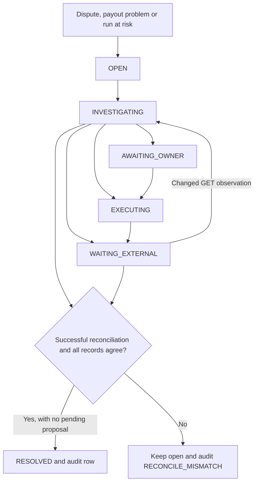

# C24: dispute rules, incident closure and what-if cash

CounterSign can now decide whether stored dispute evidence is safe to submit, keep refunds with the owner, and compare a payout run with and without its disputed shares. An incident closes only after a successful reconciliation cycle confirms that the external resource and our obligations, reservations and journal history agree.

## The three new shield rules

`REFUND_POLICY` always asks the owner about `ACCEPT_CLAIM`. It blocks a request above the dispute amount, a per-order limit or a per-day limit. Both limits use `{"minor": integer, "currency": "USD"}`. An accept-claim can refund the full dispute even if a model proposes a smaller amount, so the full claim is checked against the budget. Observed refunds and committed or ambiguous accept-claims count against it. Unknown refund dates and unresolved old claims are counted conservatively against today. Unlinked disputes still count against the daily limit.

`EVIDENCE_INTEGRITY` accepts records from the order linked to the dispute. The capture, currency and amount must agree. Model notes, buyer prose and unknown record references are blocked. Stored references use `order:<internal UUID>` or `order:<PayPal order ID>`, `capture:<capture ID>` and `tracking:<tracking number>`. At least one tracking reference is required. Optional `params.evidences` must equal the body constructed from the stored tracking records, without notes. The executor must construct this body from those records too.

Tracking is merchant-uploaded. The detail says when `tracking_number_validated` is not literally true. Even a validated tracking number is not a promise that PayPal will accept the evidence or decide for the seller.

Evidence is autonomous only when the dispute is `WAITING_FOR_SELLER_RESPONSE` and has a `provide_evidence` action link. There is no lifecycle-stage restriction. D8 had this link at CHARGEBACK; D9 did not. A missing link blocks the proposal.

`DEADLINE_GUARD` uses the stored `seller_response_due_date`. An absent deadline or a reached deadline blocks the dispute action. A close deadline flags owner-tier actions, while valid autonomous evidence can still proceed before the deadline. The positive integer policy `deadline_close_seconds` defines close. The core facade and demo-script seeds install the owner-approved value `172800` (48 hours). Explicit input overrides it, and reseeding never overwrites a later owner change. A missing or invalid threshold requires owner attention. Waiting, drafting and asking the owner remain available.

The snapshot adds trailing fields with empty or None defaults. `load_rule_facts` enriches it from database rows inside the existing transaction. This helper does not change the canonical payload or its hash. The executor must continue to use `load_context` and re-run the entire registry before sending a write.

## How an incident closes



The lifecycle uses the existing incident FSM and compare-and-swap updates. A public transition cannot request `RECONCILED`. The lifecycle wrapper runs after the existing poller, preserving worker scheduling and the facade response shape. It supplies only committed GET mirrors to closure checks. Busy or failed cycles cannot close an incident. C15 retires terminal disputes after their earmarks close, so their last verified resolution remains usable only while its financial marker matches and there is no later or unresolved dispute write. A later terminal-dispute update must enter through the inbox GET path; this card does not change the poller's resource selection.

The service discovers disputes, payout items needing attention and payout runs whose cash is unknown or insufficient. Existing reconciliation incidents remain part of the same queue. It adds missing `INCIDENT_OPENED` audits for older producers without rewriting their subjects. In particular, the executor's `PAYOUT_ITEM` rows already in `AWAITING_OWNER`, with an operation, attempt, reason and age, are accepted unchanged.

For a resolved dispute, the GET outcome, recorded financial-resolution marker, linked maker share, reserve release or consumption, and any partial-loss adjustment must match. Pending refund cash reconciliation prevents closure. Unknown D10 outcomes stay open; this card adds no guessed outcome map.

For a payout, the item identity, amount, state, active allocations, line, obligations, reservations and submission/outcome journals must match. Pending or unknown payouts stay open. Clawbacks that require a line review remain open because C10 has no PAID-to-UNPAID transition. A run-at-risk incident closes only after the run is DONE and its lines reconcile. Generic reconciliation subjects without a supported resource identity remain open for investigation.

`INCIDENT_RESOLVED` is recorded once. Unchanged observations do not create repeated mismatch audits or trigger another model step. A changed observation can return a waiting incident to investigation; a resource changing after resolution can open a new incident.

## What the simulator answers

The C23 `simulate` tool now receives a default `RunSimulator`. It accepts:

```json
{"run_id": "<internal run UUID>", "respect_reserves": true}
```

Repeat with `false` to include disputed shares as a counterfactual. The output explicitly says it is not executable. No reserves are released and no payout is sent. Both cases use the same cash observation.

The run horizon follows planning: unpaid obligations due through the run's week, excluding active allocations to other runs. Positive and negative shares are netted per maker. Executing or finished runs return an unavailable result so already submitted money is not projected as a fresh payout.

The simulator reads under a repeatable-read, read-only PostgreSQL transaction. The database itself rejects writes. It uses the existing formula:

- Effective available = reported available minus outflows submitted after the reporting refresh.
- Free cash = effective available minus active cash reservations.
- Replace this run's own cash reservation with the simulated payout, so it is counted once.
- Dispute earmarks are shown separately and never subtracted from available again.

Unknown balances, missing refresh times and pending refund cash guards produce an unavailable result. A future inflow does not become spendable merely because the simulator predicts it.

The demo arithmetic is $1,340 available, $414 of disputed maker shares and $1,086 paid with reserves respected, leaving $254. Ignoring reserves proposes $1,500 and a $160 shortfall. All returned money is integer minor units.

## Checks and handoff

Tests use an isolated random PostgreSQL schema and fake PayPal HTTP through the local mock. There are no live PayPal or model calls. The coverage includes missing facts, stored-evidence matching, aggregate refunds, stale incident updates, external confirmation before closure, the executor's existing owner-waiting subject, read-only enforcement and the exact demo cash numbers.

From this worktree, use `CounterSign-db/.venv` and `PYTHONPATH=src`. Set `COUNTERSIGN_TEST_DATABASE_URL` to a dedicated PostgreSQL 16 test database, then run `python -m pytest -q`, `ruff check .` and `lint-imports`.

C19b supplies evidence sending, cancellation and claim acceptance. Its trusted request construction, canonical binding and execution checks are preserved. The combined facade test now sends exactly one stored-tracking evidence request through the shield, worker, executor and mock at CHARGEBACK. No live PayPal or model calls are used. A model cannot supply or change the deadline policy.

This branch has been rebased onto `main` at `505e213`, after C19b merged. It has not been pushed or merged back to main.


## Changed files

| Files | Purpose |
| --- | --- |
| `src/countersign/shield/snapshot.py` | Trailing optional dispute and rule facts; original fields and action capability sets preserved |
| `src/countersign/shield/rules/{__init__,facts,refund_policy,evidence_integrity,deadline_guard}.py` | Rule registration, pure fact readers and the three C24 rules |
| `src/countersign/approvals/service.py` | `load_rule_facts` helper and its single call in `load_context`; existing payload and hash construction preserved |
| `src/countersign/incidents/{__init__,checks,service}.py` | Incident discovery, FSM/CAS lifecycle, reconciliation checks and poller composition |
| `src/countersign/simulator/{__init__,service}.py` | Read-only integer cash comparisons |
| `src/countersign/harness.py` | Lifecycle/simulator wiring and the owner-approved deadline seed default; C19b behavior wiring preserved |
| `scripts/seed_marketplace.py` | The same 48-hour policy default for the core demo-script seed |
| `tests/unit/shield/{test_c24_rules,test_shield_engine}.py` | New rule cases and updated registry expectations |
| `tests/unit/agent/test_injection_guard.py` | Keep injection assertions while supplying the added authoritative-fact query and fields |
| `tests/integration/{test_c24,test_c24_simulator}.py` | Database/mock checks for facts, cash simulation, commander verdicts and incident closure |
| `tests/integration/test_agent_harness.py` | Reuse discovered incidents and supply explicit policy in approval fixtures |
| `tests/integration/approvals/test_approvals.py` | Supply the linked order, deadline, link and policy required by claim approval |
| `tests/integration/executor/test_actions.py` | Supply authoritative C24 facts while retaining C19b execution assertions |
| `tests/integration/inbox/test_inbox.py` | Verify the script seed default, explicit override and preservation of owner changes |
| `docs/DECISIONS.md`, this page and `docs/walkthrough/README.md` | Design reasons, usage and walkthrough index |

The policy keys are `refund_limit_per_order`, `refund_limit_per_day` (both already named in CONTRACTS), and the new `deadline_close_seconds`. Both core seeds default the threshold to `172800` (48 hours); owner can change it. Explicit policy input wins over the default. Missing refund policies block; a missing deadline threshold requires owner attention.


## Rebase onto C19b

The branch was rebased onto `main` at `505e213`. Four files conflicted:

| Conflict | Resolution |
| --- | --- |
| `docs/DECISIONS.md` | Retained every C19b and C24 row |
| `src/countersign/approvals/service.py` | Retained C19b's `behavior` argument, payload/hash/request binding and all existing code; C24 facts remain in `load_rule_facts`, called once |
| `src/countersign/harness.py` | Retained C19b executor/behavior wiring alongside C24 incident, commander and simulator wiring |
| `tests/integration/approvals/test_approvals.py` | Retained the claim-link prerequisite and supplied C24's linked order, response deadline and limits |

`shield/snapshot.py` merged automatically. The existing dataclass fields remain in their original order; C24 adds trailing fields only. `PAYING` and C19b's `EXECUTABLE` are unchanged. The C19b executor, worker and request-builder files are byte-for-byte unchanged from main. An AST comparison verifies that removing the one C24 helper call makes `load_context` identical to main, including its request and hash construction.

The combined fixtures now supply real stored capture/tracking identities, action links, seller deadlines and policies. The commander integration test verifies an autonomous ALLOW at CHARGEBACK followed by exactly one successful stored-tracking evidence operation through C19b. Missing links still fail closed in C19b's preserved precondition check.

## Policy seed and Aman handoff

The two core seed paths are `Engine._seed_marketplace` in `harness.py` and `scripts/seed_marketplace.py`. Both default `deadline_close_seconds` to `172800` and let explicit input win. Tests cover the default, a scenario override and a later owner edit surviving an idempotent reseed. The shield has no hardcoded fallback: a missing row outside these seeds still requires the owner.

Aman's `eval/validate.py` `Policy` model and generated `eval/scenario.schema.json` currently allow only maker share and refund limits; the schema rejects extra keys. Core fallback already covers CounterSign runs, so existing scenarios work. To encode the threshold explicitly for reproducible eval policies, Aman must add an optional positive-integer `deadline_close_seconds` field with default `172800`, regenerate the schema, and then add scenario values where desired. No Aman-owned file was edited.

No further C19b runtime change was needed. Refund source and unresolved D10 outcome facts remain governed by their existing verification switches.


## Verification after rebase and the 48-hour seed change

- Full `python -m pytest -q --tb=short -rs`: **2,066 passed, 6 skipped, 0 failed**, one existing Starlette/httpx deprecation warning; 285.55 seconds.
- Skips: one C09 recording/index test and five optional PayPal Agent Toolkit/LangChain checks. No dependencies were added.
- Focused combined integration run: **101 passed**, including all C19b action tests, commander evidence execution, approvals, lifecycle and core/script seed defaults.
- `ruff check .`: **0 issues**.
- `lint-imports`: **3 contracts kept, 0 broken**; 86 files and 285 dependencies analyzed.
- `git diff --check`: clean.

Verification used isolated random schemas in a temporary PostgreSQL 16 container with memory-backed storage and default durability settings. PayPal calls used only the local mock or stubbed HTTP; model output was scripted. The temporary container is removed after verification. Main stays at `505e213`; this branch is not pushed or merged.
