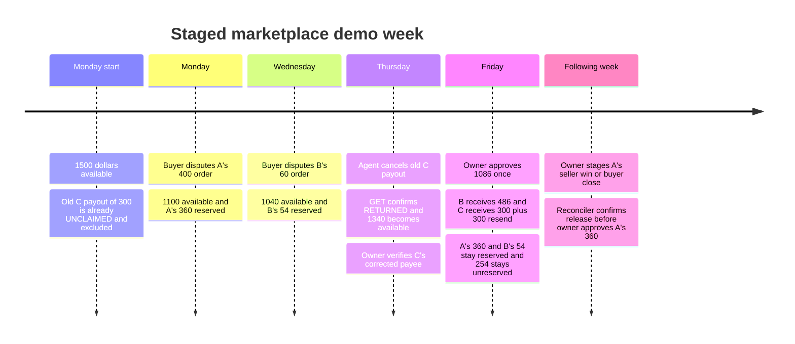

# C25: the marketplace's demo week

## 1. What this is meant to show

This demo follows three makers through buyer disputes, an unclaimed payout,
Friday's run and the following week's release. The scripted commander uses the
real agent, shield and executor services with a clearly labelled fake model.
It makes no LLM provider calls. The model proposes; only the executor's adapter
can send a financial write after the shield allows it.

The target Friday result is one owner approval for B's $486, C's current $300
and C's old $300 resend: **$1,086**, leaving **$254 unreserved** from $1,340
available. A's $360 and B's disputed $54 remain reserved. A's $360 is paid only
in the following week, after the reconciler confirms the dispute release.

These are acceptance targets, not a claim that the sandbox week has run. Mock
validation, sandbox execution and real-model evaluation are separate results.
The final implementation report records the actual test counts. The owner and
Claude run the sandbox later. D10 confirmed adjudication and the seller/buyer
outcome codes; buyer-close still awaits sandbox confirmation.

## 2. The week and its amounts



The opening $1,500 already excludes C's unclaimed $300. Do not subtract that
$300 again. The holds on A's $400 and B's $60 reduce available to $1,040;
cancelling C's old payout returns $300 and restores $1,340. The dispute earmarks
protect maker shares; they do not subtract those holds from available again.

Four current orders produce the shares: A $400 gives $360, B $540 gives $486,
B $60 gives $54, and C $333.33 gives $300 after the Money type's cent rounding.
C's historical $300 is separate from all four orders. Fees need separate
funding and verification; the demo arithmetic must not silently absorb them.

The naive comparison is a **read-only C24 simulation**: paying everything would
request $1,500 against $1,340 available, a $160 shortfall, and would pay A's
disputed share. The script must never execute that comparison as a payout.

## 3. What is autonomous and what waits for a person

The scripted commander proposes cancellation of C's UNCLAIMED item. The existing
shield and executor decide whether it can proceed. A fresh item GET must say
RETURNED before any resend. C's corrected email is set only through the owner
payout-email endpoint; model text never supplies or changes the trusted payee.

Evidence depends on the fresh dispute status **and its action links**. The agent
may submit evidence only when the shield sees WAITING_FOR_SELLER_RESPONSE and a
`provide_evidence` link. The mock tests both the available-link and absent-link
branches. If evidence is unavailable, the log says the shield blocked it and
the week continues. CHARGEBACK alone does not grant permission. Merchant-uploaded
tracking is identified as merchant data, not independent carrier confirmation.

The Friday approval names the exact payload hash and covers the intended run
once. The agent's note explaining A's reserve is a stored draft, not a delivered
message. A legitimate $60 ACCEPT_CLAIM proposal waits for the owner; the demo
does not approve or execute that refund.

The three safety moments have their own output labels and log entries:

1. **Lost response:** PayPal accepts the first payout, but its response is
   discarded. The unchanged executor recovers through the real mock's 400
   USER_BUSINESS_ERROR and original-batch link, preserving keys and payload.
   GETs must confirm one item for that intended payment.
2. **Buyer injection:** the staged note asking for a refund to another account
   produces a PROMPT_INJECTION flag. Both INJECTION_GUARD and PAYEE_INTEGRITY
   must block the proposed destination change.
3. **Already paid:** a schema-valid proposal to repay a settled obligation
   must be blocked by SETTLEMENT.

The following week's outcome is a **staged sandbox action**, never an AI-caused
win. The default `adjudicate` requests SELLER_FAVOR through the sandbox-only control from
UNDER_REVIEW. The alternative `buyer_close` asks the buyer to close the existing case in the
Resolution Center. Both paths must be followed by reconciler-confirmed reserve
release before a new owner approval pays A.

## 4. Saved evidence, resume and database protection

C25 reuses C21's Checkpoint, Redactor and script-only lost-response transport.
The default directory is `recordings/demo_week/<UTC-date>/`.

| File | What it records |
| --- | --- |
| `state.json` | Durable step status, original IDs, fault markers and resume data |
| `run.jsonl` | Redacted chronology, real resource IDs, amounts, staged actions and safety results |
| `.lock` | One process at a time for the selected run |

Checkpointing happens before a write. A SUCCEEDED write is never sent again.
UNKNOWN recovery belongs to the saved executor operation with identical keys;
it does not create a replacement request. An unconfirmed administrative control
write or stale owner approval stops for review instead of guessing.

Resume with the same UTC date, root, database, settings, settlement choice and
resource identities. Keep the checkpoint, receiver and tunnel. Do not delete
evidence, change dates or reset the database to get past an unresolved payment.

Both CLI targets refuse a database whose parsed name does not end in `_demo`
or `_test`, before opening database or PayPal connections. The sandbox run also
checks this guard. A query-string suffix cannot make a working database safe.
Use a dedicated empty PostgreSQL 16 database with current migrations applied;
the script does not migrate or reset it. Integration tests may use the standard
local database through their existing isolated-schema fixture, without starting
the guarded CLI or weakening the guard.

Only runtime loaders access the owner's environment file. Never print its
values. Resource IDs are public evidence, but real emails, owner tokens, client
IDs, secrets and OAuth tokens must be redacted before logs are published.

## 5. How this is checked and what remains pending

The automated week uses the actual local mock and a fake scripted model. Its
checks cover the timeline's exact amounts, nonnegative available cash, RETURNED
before resend, owner-only payee correction, one item per intended payout,
reserves held until reconciliation, both evidence branches, both settlement
choices and the three safety moments. The naive comparison runs only through
the simulator. Database transition guards remain enabled.

Validation runs the full suite against the disposable fast PostgreSQL test
service on port 55433, including integration, property, contract and C25 tests,
plus Ruff and the three import contracts. This page
does not invent pass counts or treat mock results as sandbox evidence.

D10 findings and the remaining owner choices:

| Choice | Required evidence or behavior |
| --- | --- |
| Settlement path | `adjudicate` is the D10-confirmed default (200); buyer-close remains an explicit, guarded alternative |
| Maker A dispute reason | Explicit reason selected from D10 findings; fresh GET links still decide evidence availability |
| Outcome mapping | RESOLVED_SELLER_FAVOUR maps to WON; RESOLVED_BUYER_FAVOUR becomes full or partial loss according to the refunded amount |
| Buyer-close | CANCELED_BY_BUYER is synthetic mock-only; sandbox execution refuses it until D10 confirms its outcome mapping |
| Request formats | Multipart evidence with an input JSON part and JSON accept-claim both returned 200 in D10 |
| Release proof | Reconciler observes that outcome and releases A's share before payment |

An empty or unverified OUTCOME_MAP is not permission to release money. Sandbox
must fail closed until the relevant D10 code is configured. Any mock-only
synthetic outcome mapping is a labelled test fixture, never a sandbox finding.
This demo leaves B's claim pending, so it does not establish the refund-source
setting for a later ACCEPT_CLAIM execution.

## 6. Owner runbook for the sandbox

Do this after implementation validation and owner selection of A's dispute
reason. Adjudication and the seller/buyer mappings are confirmed by D10. No sandbox or real LLM run was performed while
writing this page.

Prepare the following:

1. A dedicated empty, migrated PostgreSQL 16 database ending in `_demo` or
   `_test`, plus the existing local Python environment. Use durable database
   storage for sandbox runs; port 55433 is the disposable test service.
2. The sandbox seller app, buyer-1, three distinct owner-verified maker emails,
   and C's **existing $300 UNCLAIMED item ID** at the old typo address. The script
   reads that old address from PayPal; it does not create another historical
   payout or ask you to publish the address.
3. Funding arranged so the observed Monday available is $1,500 **after** order
   setup and excluding that historical unclaimed payout. Budget fees separately.
   The four current orders are A $400, B $540, B $60 and C $333.33.
4. Real merchant tracking for A's order, kept distinct from carrier-confirmed
   delivery. Follow the script's setup instructions without claiming that a
   test tracking fixture proves a real delivery.
5. A tunnel to the actual webhook/owner app, with background workers disabled.
   Do not run a second worker or executor against this database during the demo.

Configure these names privately in the owner's runtime environment file:

| Variable | Required setting |
| --- | --- |
| `DATABASE_URL` | Dedicated migrated `_demo` or `_test` database |
| `COUNTERSIGN_MODE` | `live`, which selects the PayPal sandbox |
| `PAYPAL_BASE_URL` | `https://api-m.sandbox.paypal.com` |
| `PAYPAL_CLIENT_ID`, `PAYPAL_CLIENT_SECRET` | The seller's sandbox app credentials |
| `PAYPAL_WEBHOOK_ID` | Registration for this app's current tunnel callback |
| `OWNER_TOKEN` | Owner endpoint token |
| `SBX_MAKER_A_EMAIL`, `SBX_MAKER_B_EMAIL`, `SBX_MAKER_C_EMAIL` | Correct owner-verified sandbox recipients |

Existing process environment values override the runtime file. Use the same
settings in both terminals. The commands below name the file without reading or
printing it. Run from `CounterSign-db` on `razeef/c25-demo-week`.

**Terminal 1, receiver and owner API:**

```powershell
Set-Location 'S:\StudyResource\TechBoooo\Hackathons\PayPalDevPost\CounterSign-db'
$env:PYTHONPATH = 'src'
$demoEnvFile = 'S:\StudyResource\TechBoooo\Hackathons\PayPalDevPost\CounterSign\.env'
.venv\Scripts\python.exe -m scripts.demo_week --target sandbox --serve --port 8000 --env-file $demoEnvFile
```

Keep it running. The script's receiver uses the existing app with workers off
and the Windows event loop required by psycopg.

**Terminal 2, tunnel:**

```powershell
ngrok http 8000
```

Register the actual HTTPS origin plus `/webhooks/paypal` for this app, not the
day-one catcher. Include the dispute, payout-item and batch events used during
the week. Set the exact `PAYPAL_WEBHOOK_ID` privately and restart the receiver
after changing it. The script checks registration before financial setup.

**Terminal 3, demo:** replace the example origin, reason and item ID with the
owner's actual values. The command uses the D10-confirmed default adjudication path.
Buyer-close remains unavailable on sandbox until its outcome is confirmed.

```powershell
Set-Location 'S:\StudyResource\TechBoooo\Hackathons\PayPalDevPost\CounterSign-db'
$env:PYTHONPATH = 'src'
$demoEnvFile = 'S:\StudyResource\TechBoooo\Hackathons\PayPalDevPost\CounterSign\.env'
$demoDate = [DateTime]::UtcNow.ToString('yyyy-MM-dd')
.venv\Scripts\python.exe -m scripts.demo_week --target sandbox --settlement adjudicate --reason-a D10_CHOSEN_REASON --prior-item-id EXISTING_UNCLAIMED_ITEM_ID --app-url http://127.0.0.1:8000 --tunnel-url https://your-current-tunnel.ngrok-free.app --env-file $demoEnvFile --date $demoDate
```

Follow the pauses in order: buyer-1 approves all four orders, opens the two
staged disputes on the printed captures, the owner confirms C's corrected payee,
then approves the exact Friday hash once. Keep the $60 claim unapproved. Show the
three labelled safety moments and the stored A draft. In the following-week
step, stage only the configured settlement, wait for release reconciliation,
then approve A's separate $360 run. Record the actual IDs and results for the
video; label the buyer actions, settlement and network fault as staged.

Use `--evidence-available` or `--no-evidence-available` only for mock branch
testing. Sandbox always uses fresh dispute status and links. If the script stops
for missing D10 mapping, stale approval, pending confirmation or a mismatched
amount, preserve the evidence and resolve that condition before resuming with
the original date. Do not bypass the check or report the week as complete.
