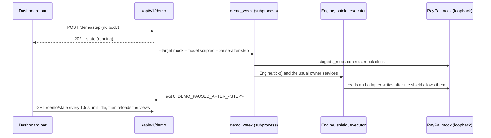

# M17: the demo control bar

## What it is

A strip under the **Simulated: mock PayPal** banner, on every dashboard view, that
lets the presenter play C25's staged week one step at a time while recording the
video. It appears only in demo mode on the local mock (the hosted container). In
live mode the endpoints are not mounted and the strip stays hidden.

Each press replays the next checkpoint step of the same scripted week the hosted
container can seed at boot (`scripts/demo_week.py --target mock --model scripted`).
The agent is a scripted model: no LLM or PayPal call is made. Steps that contain a
staged action (buyer disputes, the dispute settlement, the lost response, the owner
clicks) carry a **staged** label.

| # | Step (as shown on the bar) | Staged |
| --- | --- | --- |
| 1 | Monday: stage four buyer orders on the mock; C's old $300 payout is UNCLAIMED | yes |
| 2 | Monday: load makers, orders and maker shares; $1,500 available | yes |
| 3 | Monday: buyer disputes Maker A's $400 order; A's $360 share is reserved and the evidence path is checked | yes |
| 4 | Wednesday: buyer disputes Maker B's $60 order; B's $54 share is reserved | yes |
| 5 | Thursday: agent cancels C's UNCLAIMED $300 payout and a GET confirms RETURNED; owner verifies C's payee | yes |
| 6 | Friday: plan the run; A's $360 and B's $54 stay reserved; the naive comparison is read only | no |
| 7 | Friday: owner approves the exact $1,086 run once; a lost PayPal response is recovered with the same keys | yes |
| 8 | Friday: agent drafts a note to Maker A; B's $60 claim acceptance waits for the owner | no |
| 9 | Friday: a buyer note asks for a refund to another account, and a settled line is retried; both blocked | yes |
| 10 | Following week: A's dispute is adjudicated for the seller; the reconciler releases A's reserve | yes |
| 11 | Following week: owner approves A's $360 only after the release; $354 available | yes |

## How it works



- `GET /api/v1/demo/state` returns the CONTRACTS section 3 fields (`scenario`, `step`,
  `replaying`, `simulated`, `simulation_label`, `steps`, `next_label`) plus `total`,
  `complete`, `running`, `clock` (the staged mock clock), `model`, `staged_note`
  and `last_result` (a fixed code only).
- `POST /api/v1/demo/step` starts the next step and returns 202; 409 `DEMO_BUSY`
  while one runs, 409 `DEMO_WEEK_COMPLETE` after step 11.
- `POST /api/v1/demo/reset` empties the disposable database and mock, re-registers
  the mock webhook with the same ID and starts a new checkpoint folder. Old
  checkpoints stay on disk.
- The CLI's checkpoint lock allows one week process at a time. A press while the
  boot-time seed is still running reports `SLICE_ALREADY_RUNNING`.

## Why it cannot bypass the shield

- POST bodies are ignored. The command, target, model and folder are fixed by the
  server; the presenter only chooses *when* the next step runs.
- The bar never calls PayPal or the engine itself. The week script uses the same
  staged mock controls, `Engine.tick()` and owner services as the boot-time seed, so
  every money write still goes proposal, shield, executor, adapter.
- The endpoints exist only when the settings are demo mode, a loopback mock origin
  and a `_demo`/`_test` database name, and `COUNTERSIGN_DEMO_ROOT` and
  `COUNTERSIGN_DEMO_APP_URL` are set (the hosted start script sets both). Every
  request checks again. The reset command refuses anything but the mock target.

## Recording the video (local Docker)

```powershell
docker build -t countersign-demo .
docker run --rm -p 127.0.0.1:8080:8080 countersign-demo
# open http://127.0.0.1:8080/  (COUNTERSIGN_HOSTED_SEED stays none: an empty week)
```

1. Open the dashboard. The banner reads **Simulated: mock PayPal**; the bar shows
   *Step 0 of 11*, *Staged clock: not started* and the first step under **NEXT**.
2. Press **Run next staged step**. The button reads *Running…*; after a few seconds
   the bar shows the finished step under **LAST**, the staged clock moves and the
   desk reloads. Locally each step took 3 to 12 seconds.
3. Steps 1 to 5: the desk fills with titled incidents (for example *Dispute PP-D-… ·
   Maker A · $400.00* and *Returned payout · Maker C · $300.00*); open **Cash** to
   show $1,500 and then $1,800 after Thursday.
4. After step 6, open **Decision**: it opens the *Schedule Payout Run · Needs Owner*
   proposal with its exact payload hash, B $486, C $300 and C's $300 resend.
   Open **Payout runs** for the $1,086 run with $414 reserved, not paid.
5. Step 7 is the staged owner approval of that exact hash, including the staged
   lost response; **Execution history** shows one payment per intended payout.
   Use the bar for this approval rather than the Approve button: the mock week's
   approval expiry is on the staged clock, while the owner endpoint uses real time.
6. Step 9: **Decision** shows the injection proposal blocked by INJECTION_GUARD and
   PAYEE_INTEGRITY with the PROMPT_INJECTION flag, and the settled retry blocked by
   SETTLEMENT. Do not approve B's $60 claim: the scenario leaves it waiting.
7. Steps 10 and 11: the release is reconciled, A's $360 is paid, **Cash** shows
   $354 available and B's $54 still reserved. The bar reads *Week complete*.
8. **Restart week** asks for confirmation and returns to *Step 0 of 11* in about two
   seconds, ready for another take.

## What was checked

- `tests/dashboard/test_demo_bar.py`: allowed only in demo on the loopback mock with a
  disposable database; live apps never mount the routes; fixed CLI arguments with
  bodies ignored; one command at a time; reset moves to a new root; failures are
  fixed codes; the pause wrapper stops once per new step and never on the last;
  the CLI refuses the bar options outside the mock; static revalidation headers.
- `tests/dashboard/test_incident_titles.py`: titles from fixed fields only, masked
  emails, the read-only role.
- `web/tests/*.test.mjs`: bar rendering, staged labels, escaping, hidden in live
  mode, a single POST per click, busy/complete messages, banner text from the server.
- The hosted container (Oct 27, seed `week`, local Docker): every route rendered with
  no error banner; a full **Restart week** plus 11 presses replayed the week with the
  scripted amounts ($354 available, B's $54 reserved); a press during the boot seed
  reported `SLICE_ALREADY_RUNNING` and changed nothing.
